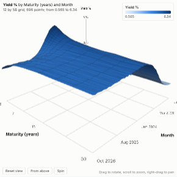

#  3D Surface

A measure drawn as a three-dimensional surface over two groupings, rendered with three.js. Yield curves over time, demand by price and lead time, sensor readings by position and hour, sales by store and week: any grid where the shape matters, as a surface you can rotate, zoom and hover. Numbers and dates are spaced to scale along each direction, text values evenly.

## Use case

Finance (yield or volatility surfaces over time), pricing and revenue management (response surfaces), manufacturing and energy (readings by position and time), operations (load by hour and day), and any marketing or board material that benefits from an explorable 3D picture of real data.

## Data

Two groupings and a measure, aggregated by Omniscope (up to 20,000 cells, for example 140 by 140). Group dates by unique values or by a period in the grouping settings. Cells with no data are left as holes in the surface.

## Settings

- **Across**, **Along**: the two groupings of the floor.
- **Height**: the measure, e.g. average Yield or sum of Bookings.
- **Colours**: automatic, low to high (one colour ramp), or below and above zero (two colours, centred on zero).
- **Height scale**: stretch or flatten the surface (default 1).
- **Grid lines**: draw grid lines on the surface.
- **Spin**: rotate the scene slowly.

## Interaction

Drag to rotate, scroll to zoom, right-drag to pan; the buttons reset the view, look from above (a heatmap view) or start spinning. Hover the surface for the values at the nearest grid point. Click to select that cell (both grouping values), so other views filter or highlight to match; click it again or click empty space to clear.

## Motion

When the view first draws, and when its data, options or filters change, the surface rises from its floor. Hovering and selecting do not replay it. The animation is skipped when the viewer's system asks for reduced motion.

## Third-party libraries

Loaded from the jsDelivr CDN when the view opens, so the browser showing the report needs internet access:

- [three.js](https://threejs.org) 0.147.0, MIT licence
- [D3](https://d3js.org) 7.9.0, ISC licence

## About this view

This view carries the `visokio-agents` tag. It is one of a set of community examples built by Visokio's agents, to extend Omniscope's core views with popular, specialist and more unusual use cases, and to show what anyone, people or agents, can build on Omniscope. It is tested by automated tests and was run on a real Omniscope server. It was not reviewed by Omniscope's core team, so it is not on a par with Omniscope's core views, which have years of manual, functional and unit tests behind them.

The sample data in `sample-data/` is invented for the demo.
