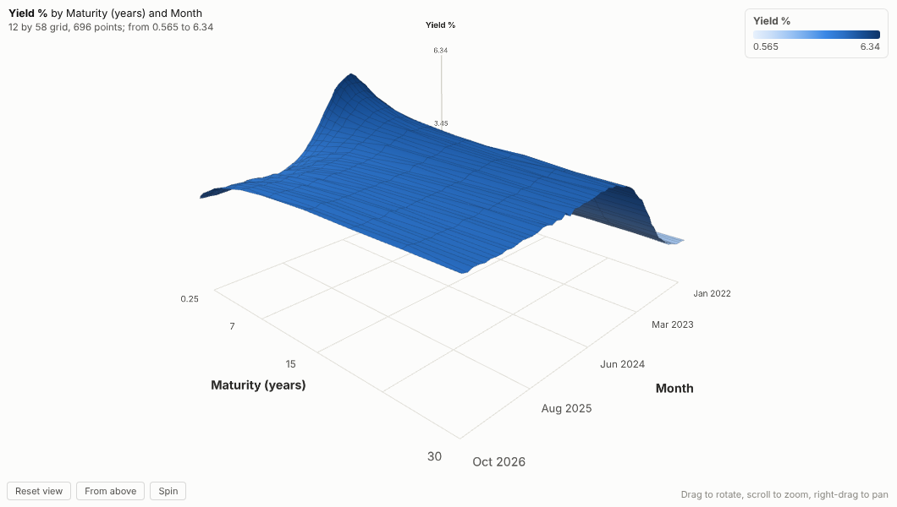
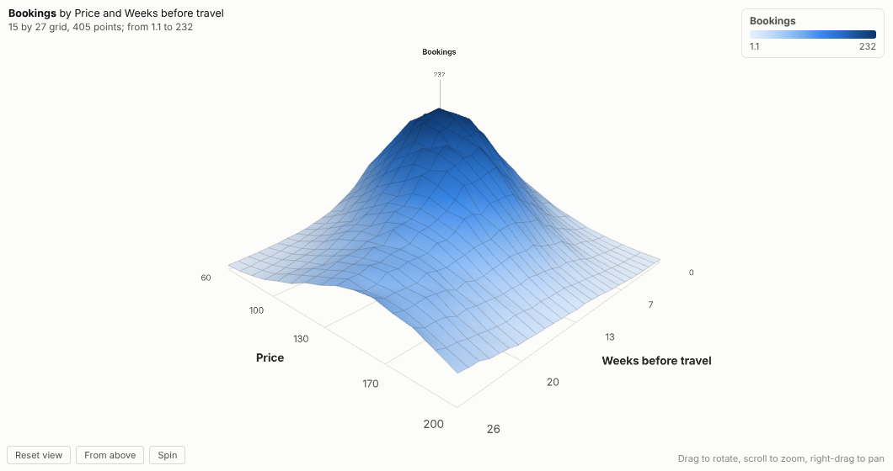
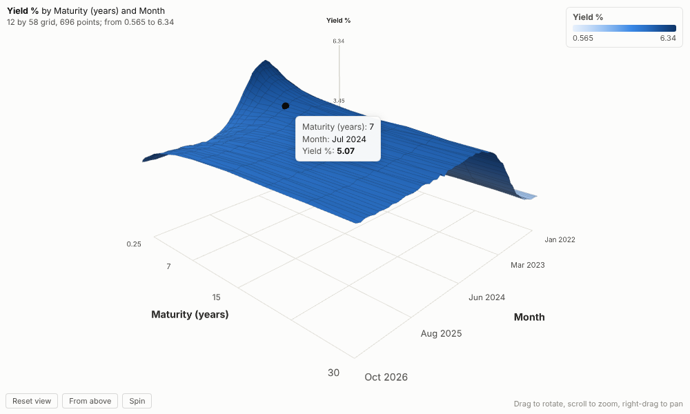
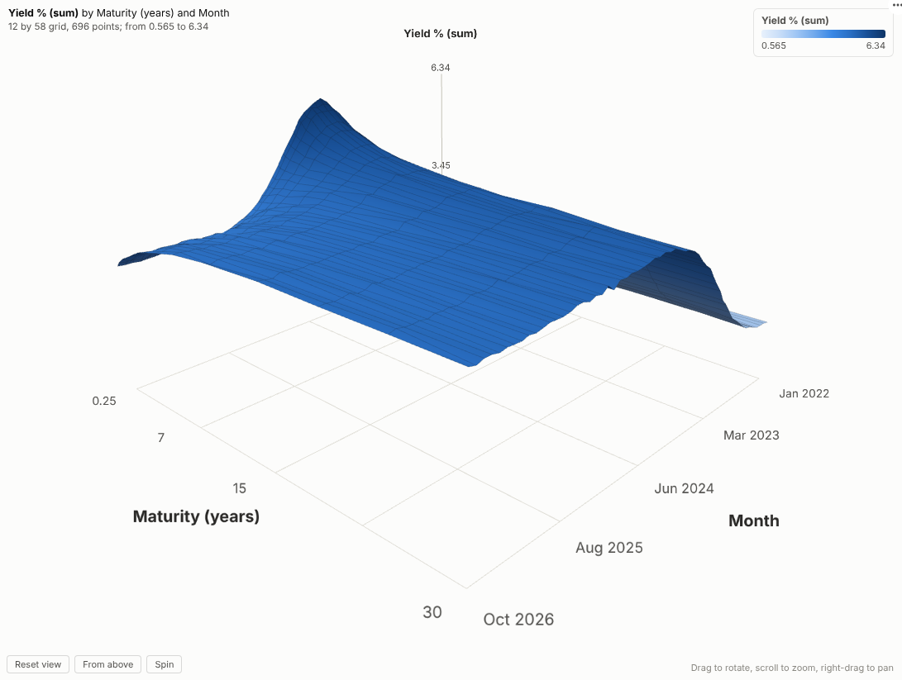

# 3D Surface

See the shape of your data. Any measure over two dimensions, drawn as a 3D surface you can rotate, zoom and click, live in an Omniscope report.

## The problem it solves

Some data is a landscape. A yield curve for every month, demand at every price and lead time, temperature at every position along a line and every hour: the interesting thing is the shape, the ridges, valleys and slopes. Line charts with dozens of series turn into spaghetti, and a heatmap hides the magnitude of the peaks. A 3D surface shows the shape directly, and it is easy to present in a meeting.

The 3D Surface view draws it from any two groupings and a measure. In the illustrative yield curves above (invented, not market data), the rise in rates through 2022 and 2023 and the inversion of the curve, with short-dated yields above long-dated ones, appear as a ridge travelling across the surface. A pricing team might look at bookings by price and weeks before travel instead:

## Where it earns its place

The examples below are illustrative.

| Team | Across | Along | Height |
|---|---|---|---|
| Treasury and markets | Maturity | Month | Yield or spread |
| Revenue management | Price | Days before arrival | Bookings or conversion |
| Manufacturing | Position on the line | Hour | Temperature or thickness |
| Energy and utilities | Hour of day | Day of year | Load |
| Retail | Store | Week | Sales or margin |

## How to use it in Omniscope

1. Bring the data into a workflow with two dimensions and a measure.
2. Connect it to a Report block, add a view and choose **3D Surface**.
3. Set **Across**, **Along** and **Height**; for dates, choose unique values or a period such as month in the grouping settings.
4. Drag to find the best angle, or use **From above** for a heatmap view.
5. Click a point on the surface to select that cell and see its detail in other views.

## Why do this in Omniscope

- **The grid comes from the workflow.** Two groupings and a measure, aggregated by Omniscope, with numbers and dates spaced to scale; the surface updates when the workflow refreshes, with no separate charting script to re-run.
- **Heights that match the data.** The tests compare grid values with the source data, so the peak you point at is the figure in the table.
- **Filter to reshape, click to drill.** Filter to a product, period or site and the surface is redrawn for that slice; a click selects that cell's records for every other view.
- **A scene to extend.** The three.js code is open; add contour lines or a second, translucent surface in the View Designer.

## Data and options

Two groupings and a measure.

| Option | What it does |
|---|---|
| Across, Along | The two groupings of the floor |
| Height | The measure |
| Colours | Automatic, low to high, or below and above zero |
| Height scale | Stretch or flatten |
| Grid lines | Lines on the surface |
| Spin | Slow rotation |

Tested with a 140 by 140 grid (19,600 cells).

## Tested

- Mock harness: grid values checked against the source data, numeric, date and text axes, hover and click with the real mouse (WebGL in headless Chromium), clearing, filtering to recent months, a narrow layout, a single row, empty data, unconfigured options, and a 140 by 140 grid.
- Real Omniscope server: installed through the Edit View API and configured in a report with both dates and numbers as unique values; identical surface.

