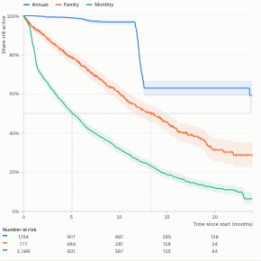

#  Survival Curve

Kaplan-Meier survival curves for any "time until something happens" question: how long customers stay subscribed, employees stay, or machines run before failing. Records that have not ended yet are handled properly (censored), which a simple average of tenures gets wrong. Compare groups side by side, with confidence bands, medians, the number at risk and a log-rank test of whether the groups really differ.

## Use case

Churn and retention by plan, channel or cohort; employee attrition by department or grade; time to failure or warranty claim by model; time to conversion, repayment or default; other time-to-event questions.

## Data

Either a **Start** and **End** date per record (End blank while still active), or a numeric **Duration** with an optional **Event flag** (whether the event happened; without it every record counts as ended). With dates, open records are counted up to the latest date in the data. The view fetches up to 500,000 records through the Query API; filters from other views apply.

## Settings

- **Start**, **End**: date fields. Blank End means still active.
- **Duration**, **Event flag**: the alternative to Start and End. The flag counts 1, true, yes and other values as an event, and 0, false, no, blank, "active" and "censored" as still active.
- **Compare**: optional field with one curve per value. The seven largest groups are shown and the rest combined as Other.
- **Time unit**: automatic (days, weeks, months or years from the span), or fixed.
- **Show**: the share still active (survival) or the share ended (cumulative churn or failure).
- **Confidence bands**: shade the 95% interval of each curve (Greenwood variance, log-log transform).

## Reading the chart

Each curve starts at 100% and steps down whenever records end. Small ticks mark records that were still active when last seen. Dashed vertical lines mark each group's median, the time by which half have ended ("not reached" when more than half are still active). The table below the chart shows how many records were still at risk at each time. The panel shows records, ended and medians per group, the share still active at three points in time, and the log-rank test: a small p-value (below 0.05) means the curves differ by more than chance would explain.

## Interaction

Hover anywhere on the chart for each group's share still active at that time, with its confidence interval and the number at risk. Click a curve, a legend entry or a row in the panel to select that group's records; click empty space to clear.

## Motion

When the view first draws, and when its data, options or filters change, the curves draw from left to right. Hovering and selecting do not replay it. The animation is skipped when the viewer's system asks for reduced motion.

## Why this rather than the core Line view

A **Line** view can draw a retention curve you have already calculated. This view calculates it: a Kaplan-Meier estimate that handles records still open (censored), with confidence bands and a log-rank test between groups. The community Strata view draws the same kind of data as a timeline, and the Survival Analysis and Churn Survival Curves blocks estimate the curves in the workflow when they are needed as data.

As a community view it is less integrated than a core view: it doesn't support every report feature (rectangle selection, for example), and it isn't covered by Omniscope's core tests.

## Third-party libraries

Loaded from the jsDelivr CDN when the view opens, so the browser showing the report needs internet access:

- [D3](https://d3js.org) 7.9.0, ISC licence

## About this view

This view carries the `visokio-agents` tag. It is one of a set of community examples built by Visokio's agents, to extend Omniscope's core views with popular, specialist and more unusual use cases, and to show what anyone, people or agents, can build on Omniscope. It is tested by automated tests and was run on a real Omniscope server. It was not reviewed by Omniscope's core team, so it is not on a par with Omniscope's core views, which have years of manual, functional and unit tests behind them.

The sample data in `sample-data/` is invented for the demo.
