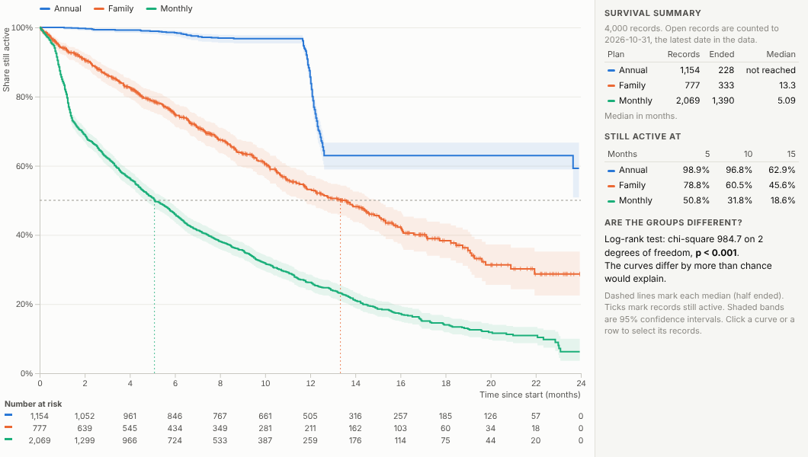
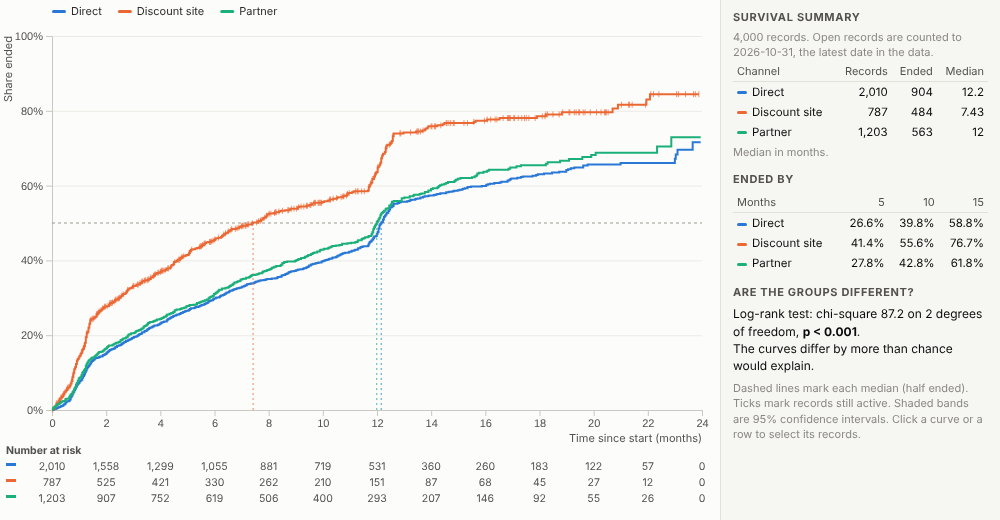
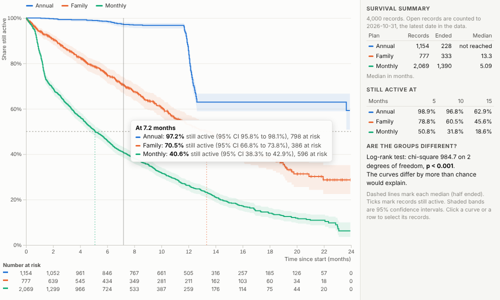
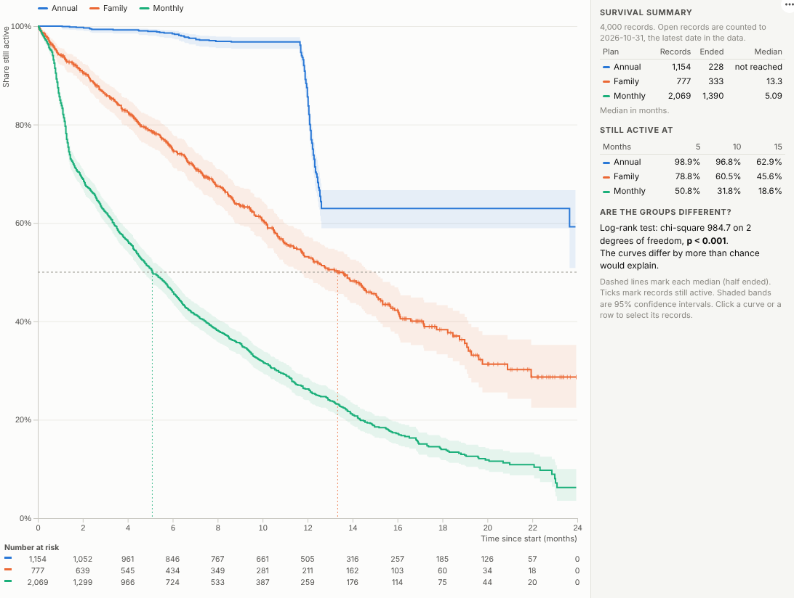

# Survival Curve

How long do customers stay? How long do machines last? Survival curves answer "time until" questions correctly, including the records that have not ended yet, and show whether the difference between groups is real.

## The problem it solves

Retention, attrition and failure questions all share a trap. At any moment many customers are still subscribed, many employees still employed, many machines still running, so their final tenure is unknown. Averaging the tenures of those who have left understates how long people stay; ignoring the ones still active throws away most of the data. Survival analysis, and the Kaplan-Meier curve in particular, is a standard way to use both, and it is routine in medicine, engineering and subscription businesses.

The Survival Curve view does it inside an Omniscope report from a start date and an end date (blank while still active), or a duration and an event flag. In the illustrative subscription data above, half of monthly subscribers have left after about five months, family plans last over a year, and annual plans hold almost everyone until the first renewal, when about a third leave. The log-rank test in the panel confirms the plans differ by far more than chance. Switch to the share ended and compare acquisition channels:

## Where it earns its place

The examples below are illustrative.

| Question | Start and end | Compare by |
|---|---|---|
| Subscription churn | Subscription start and cancellation | Plan, channel, cohort, price point |
| Employee attrition | Hire date and leaving date | Department, grade, manager, location |
| Reliability and warranty | Install date and failure date | Model, supplier, batch, site |
| Credit and collections | Loan start and default or repayment | Product, segment, region |
| Customer journeys | First visit and conversion | Campaign, source, landing page |
| Healthcare operations | Referral and treatment | Pathway, provider, priority |

## How to use it in Omniscope

1. Bring the records into a workflow with a start date and an end date (blank while still active), or a duration and an event flag.
2. Connect it to a Report block, add a view and choose **Survival Curve**.
3. Set **Start** and **End** (or **Duration** and **Event flag**) and optionally **Compare**.
4. Choose whether to show the share still active or the share ended.
5. Click a curve to select its records; filter other views (region, period) to re-estimate the curves for that slice.

## Why do this in Omniscope

- **Records in, estimates out.** Start and end dates are prepared in the workflow, and the curves are recalculated whenever it refreshes, so retention reporting stays current without re-running an analysis by hand.
- **Estimates that were checked.** The tests compare the Kaplan-Meier estimates and the log-rank statistic with an independent calculation.
- **Re-estimated for each cohort, then traced to people.** Filter to a region or cohort and the curves, medians and test are recalculated; click a curve to see who those customers are in the other views.
- **Add the statistic you need.** The Kaplan-Meier, Greenwood and log-rank code is in the view; add a restricted mean or a hazard ratio in the View Designer.

## Data and options

A start and end date per record (end blank while active), or a numeric duration with an optional event flag.

| Option | What it does |
|---|---|
| Start, End | Date fields; blank End means still active |
| Duration, Event flag | Alternative input: time and whether the event happened |
| Compare | One curve per value (up to 7 plus Other) |
| Time unit | Automatic, days, weeks, months or years |
| Show | Share still active or share ended |
| Confidence bands | 95% intervals around each curve |

Tested with 300,000 records in 12 groups.

## Tested

- Mock harness: Kaplan-Meier estimates and the log-rank statistic checked against an independent calculation, hover, selection, clearing, filtering to one region, a narrow layout, a single curve in weeks, empty data, unconfigured options, and 300,000 records with the Duration and Event flag input.
- Real Omniscope server: installed through the Edit View API and configured in a report; the curves and test statistic match the mock exactly.

