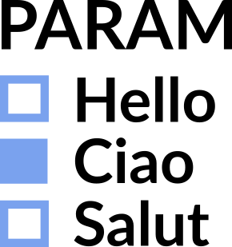

#  Switch Param

Radio buttons that set a project parameter to one of a field's values. Pick a region, a year or a scenario in the report, and the parameter changes for every block that uses it.

The view reads the parameter with `GET <project>.iox/w/param/<name>` and sets it with `POST <project>.iox/w/updateparams`, from the project's [Workflow REST API](https://help.visokio.com/support/solutions/articles/42000073133-workflow-execution-rest-apis).

## Use case

- A scenario or region switch for a workflow whose filters, formulas or database queries use a parameter.
- Choosing which file, table or period a scheduled task processes next.

Setting a parameter does not execute the workflow. Blocks that use it run with the new value at their next execution, for example by a scheduled task or a [Workflow Execution](../workflowexecution) button on the same report. To set the value and execute at once, use [Switch Param and Execute Workflow](../switchparamandexecute).

## Data

The choices are the distinct values of a field in the view's data, in Omniscope's order (sorted). Empty values are left out. The view's data follows the report's filters, so filtering the report also narrows the choices. Feed the view from a source that lists every value (for example the unfiltered data, as a second input of the report): if the list came from data filtered by the parameter itself, it would only ever offer the current value.

## Settings

- **Parameter name** (required): the project parameter to set, exactly as named in the workflow.
- **Values from** (required): the field whose distinct values become the choices.
- **Most values shown** (default 100): the view lists at most this many values and says how many there are.

## Values

The current value of the parameter is ticked when the view opens, and read again when the report's data or the view's settings change, so a change made elsewhere shows. If the current value is not among the choices (for example after filtering), the view says "Current value: ...". Number parameters are set to numbers, others to the text of the value.

## Requirements

The viewer's user needs the **Project parameters access via APIs** permission on the Omniscope server (off by default). If the server refuses a change, its message is shown and the previous value stays ticked.

## Interaction

Click a value to set the parameter; the view confirms it under the list ("Region set to South"). Clicking the value already set does nothing.

The view has nothing to select. A click on empty space clears the report's selection, as in other views; a click on a value does not.

## Third-party libraries

None: the view is plain HTML and JavaScript and needs nothing beyond Omniscope's custom view API.
