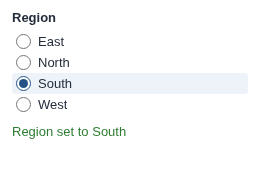

# Switch Param

Radio buttons that set a project parameter, chosen from a field's values.

## The problem it solves

A parameter that selects a region, a year or a scenario is easiest to set from a list of the values it can take. Typing it in the workflow's parameter settings is slow, and only authors can do it.

The Switch Param view lists the distinct values of a field and ticks the parameter's current value. A click sets the parameter for every block that uses it. Above, an illustrative Region parameter.

## Where it earns its place

The examples below are illustrative.

| Team | Parameter |
|---|---|
| Sales | The region a scheduled export covers |
| Finance | The budget scenario: base, upside, downside |
| Data team | The source system a task loads next |

## How to use it in Omniscope

1. Create the project parameter and use it in blocks.
2. Give the users who should change it the **Project parameters access via APIs** permission.
3. Connect a source listing every value (for example the unfiltered data) to the report.
4. Add a view, choose **Switch Param**, set **Parameter name** and **Values from**.
5. To run the workflow after a change, add a [Workflow Execution](../../workflowexecution) button, or use [Switch Param and Execute Workflow](../../switchparamandexecute) instead.

## Why do this in Omniscope

- **Choices from the data.** The values offered are the field's values in the report's data, so a new region in the data is a new choice, with no list to maintain.
- **Sets the workflow, not just the report.** Report filters change what the report shows; a project parameter changes what the workflow does, for every block and scheduled task that uses it.
- **Small and adaptable.** One HTML file making two documented Workflow REST API calls, one to read the parameter and one to set it; in the View Designer it can show the values as a drop-down list instead of radio buttons.

## Data and options

A field with the values to offer.

| Option | What it does |
|---|---|
| Parameter name | The project parameter to set |
| Values from | The field whose values are offered |
| Most values shown | Limit on the list (default 100) |

## Tested

Mock harness with a stand-in for the Workflow REST API: the current value ticked on opening; a click sends one update with the chosen value and confirms it; a number parameter is set to a number, and opening the view never sends an update; clicking the current value sends nothing; a refused update keeps the previous value; an unknown parameter is reported; filtering narrows the choices and says when the current value is not among them; a 120 by 70 pane; empty data; no settings; and 3,000 values (the first 100 shown, and the limit changed to 25).
