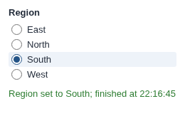

# Switch Param and Execute Workflow

Pick a value, and the workflow re-runs with it: a parameter switch for reports built by a parameterised workflow.

## The problem it solves

When a report's data comes from a workflow driven by a parameter (a region in a database query, a scenario in a model), changing the parameter is only half the job: the workflow must then run again before the report changes.

The Switch Param and Execute Workflow view does both on one click: it sets the parameter to the value picked, then executes the blocks you name and follows the job. Above, an illustrative Region parameter and a Report block.

## Where it earns its place

The examples below are illustrative.

| Team | Switch |
|---|---|
| Sales | A region switch on a dashboard fed by a parameterised database query |
| Finance | Budget scenarios computed by a model block |
| Operations | The depot whose live orders are loaded from an API |

## How to use it in Omniscope

1. Create the project parameter and use it in blocks (a filter, a query, a formula).
2. Give the users who should switch it the **Project parameters access via APIs** and **Workflow Execution via APIs** permissions.
3. Connect a source listing every value (for example the unfiltered data) to the report.
4. Add a view, choose **Switch Param and Execute Workflow**, and set **Parameter name**, **Values from** and **Blocks to execute**.
5. Turn **Refresh from source** off if only a filter or formula uses the parameter: the re-run is then quicker.

## Why do this in Omniscope

- **Recomputed, not just refiltered.** The workflow runs again with the new value, so aggregations, joins and queries that depend on it are rebuilt by the workflow's engine, and every view in the report shows the result.
- **One click, in order.** The execution starts only after the parameter has been set; if the server refuses the change, nothing runs.
- **Built on documented calls.** Setting the parameter, executing and following the job are three Workflow REST API requests in the view's source, which can be edited in the View Designer, for example to ask for confirmation first.

## Data and options

A field with the values to offer.

| Option | What it does |
|---|---|
| Parameter name | The project parameter to set |
| Values from | The field whose values are offered |
| Blocks to execute | Block names; empty runs the whole workflow |
| Refresh from source | Reload from the sources, or reuse loaded data |
| Most values shown | Limit on the list (default 10) |
| Show job state | Show the job's progress |

## Tested

Mock harness with a stand-in for the Workflow REST API: the current value ticked on opening; a click sends the update and then one execution of the named blocks, with the values disabled until the job has finished; a number parameter set to a number, and opening, filtering or resizing never sends an update or an execution; clicking the current value sends nothing; a refused update keeps the previous value and executes nothing; an unknown parameter is reported; filtering; a 120 by 70 pane; empty data; no settings; and 3,000 values (the first 10 shown); and a reload of the view in the middle of a run (the view resumes and shows the result).
