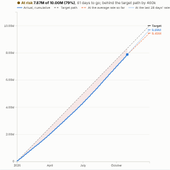

#  Target Tracker

Are we going to hit the target? Cumulative progress through a period against a target path, with two projections to the end of the period (at the average rate so far and at the recent rate), the gap to the path, and the daily rate needed from here. A status reads Target reached, On track, At risk or Off track, with an icon and words as well as colour.

## Use case

Sales and bookings targets, fundraising and membership goals, production or delivery quotas, budget spend against an allocation, energy or carbon budgets, recruitment targets: any total that should reach a number by a date.

## Data

Records with a date and a measure. The view runs two aggregated queries: the latest date, then the measure per day within the period. Filters from other views apply, so a team or a region can be tracked against its own target.

## Settings

- **Dated by**: the date field.
- **Measure**: what counts towards the target, e.g. sum of Bookings (default: number of records).
- **Target**: the target for the whole period.
- **Start**, **End**: the period as yyyy-mm-dd (default the calendar year of the latest data).
- **Target path**: evenly over all days, or over working days (Monday to Friday).
- **Recent days**: the window for the recent run rate (default 28 days).

## How it projects

The average rate is the total so far divided by the days (or working days) elapsed; the recent rate uses the last Recent days. Each is extended to the end of the period from today's total. The status is On track when both projections reach the target, At risk when only one does or the better one is within 5%, and Off track otherwise. The needed rate is what remains of the target divided by the days left.

## Interaction

Hover any day for that day's value, the cumulative total and the target path. Click a day to select everything from the start of the period to that day, so other views show the detail; click again or click empty space to clear.

## Motion

When the view first draws, and when its data, options or filters change, the actual and target lines draw from left to right. Hovering and selecting do not replay it. The animation is skipped when the viewer's system asks for reduced motion.

## Third-party libraries

Loaded from the jsDelivr CDN when the view opens, so the browser showing the report needs internet access:

- [D3](https://d3js.org) 7.9.0, ISC licence

## About this view

This view carries the `visokio-agents` tag. It is one of a set of community examples built by Visokio's agents, to extend Omniscope's core views with popular, specialist and more unusual use cases, and to show what anyone, people or agents, can build on Omniscope. It is tested by automated tests and was run on a real Omniscope server. It was not reviewed by Omniscope's core team, so it is not on a par with Omniscope's core views, which have years of manual, functional and unit tests behind them.

The sample data in `sample-data/` is invented for the demo.
