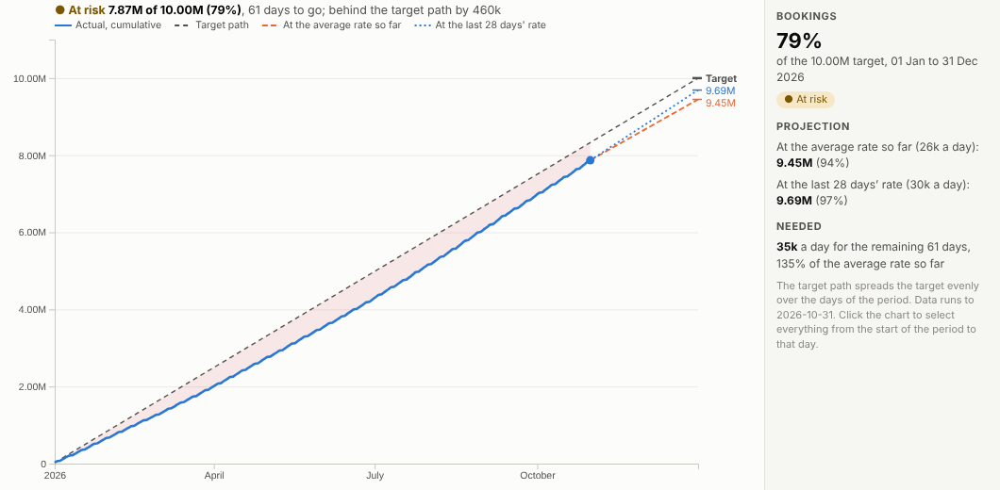
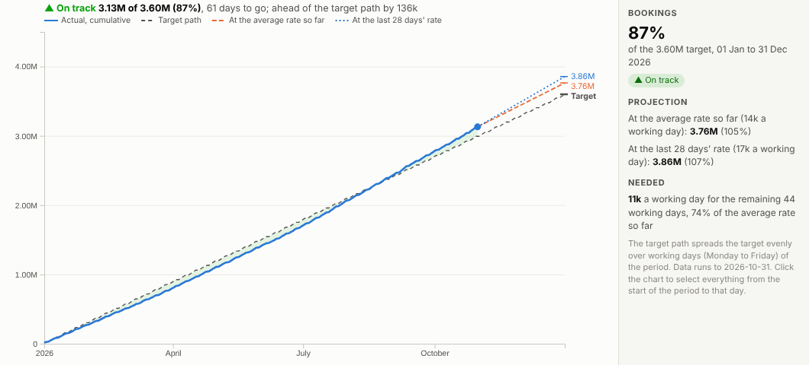
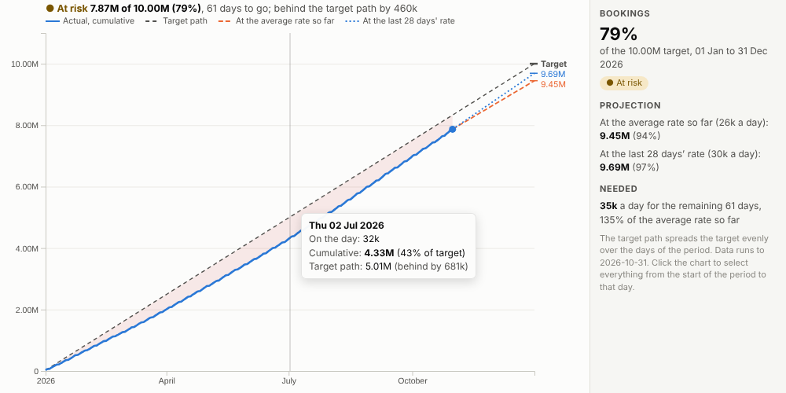
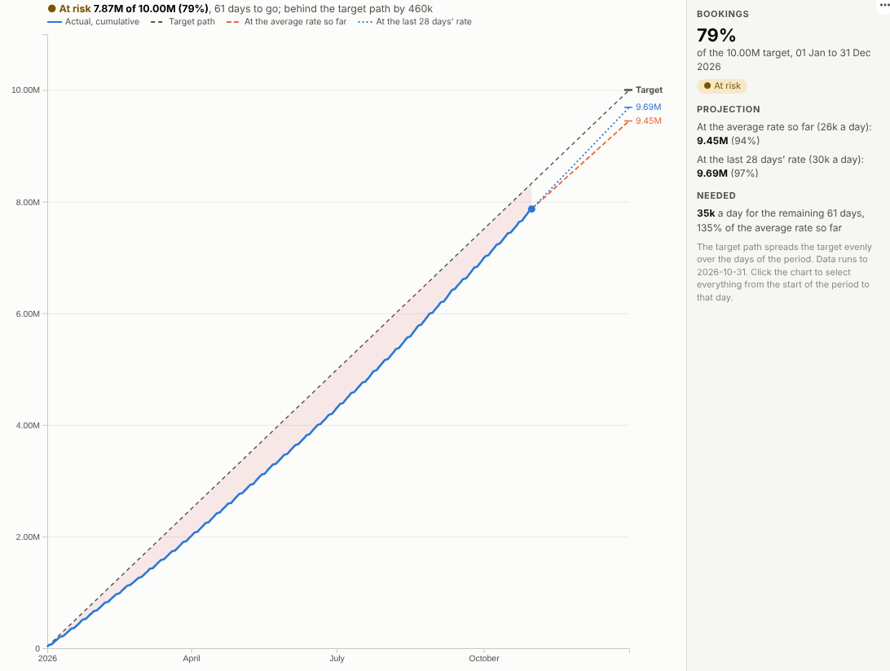

# Target Tracker

Will we make it? Progress against a target, the projection to the end of the period, and the rate needed from here, live from your data.

## The problem it solves

Every sales team, fundraiser and operations manager has a number to hit by a date. The usual report shows the total so far and a percentage, which does not answer the real questions: are we ahead or behind where we should be by now, where will we end up at this pace, and what do we need to do from here? Those answers are usually worked out in a spreadsheet on the side.

The Target Tracker view answers them on the dashboard. In the illustrative bookings above, 79% of the 10M annual target is in with 61 days to go, 460k behind the target path. At the average rate so far the year ends at 9.45M; at the faster recent rate, 9.69M. Hitting the target needs 35k a day, about a third more than the average so far. Filter to one team with its own target, spread over working days:

## Where it earns its place

The examples below are illustrative.

| Team | Measure | Period |
|---|---|---|
| Sales | Bookings, revenue, new accounts | Quarter or year |
| Fundraising and membership | Donations, members | Campaign or year |
| Operations | Units produced, orders shipped | Month |
| Finance | Spend against allocation | Financial year |
| Sustainability | Energy or carbon against a budget | Year |

## How to use it in Omniscope

1. Bring the transactions into a workflow with a date and a measure.
2. Connect it to a Report block, add a view and choose **Target Tracker**.
3. Set **Dated by**, **Measure** and the **Target**; set **Start** and **End** for a period other than the calendar year.
4. Choose whether the target builds up over all days or working days.
5. Filter by team or region in other views to track each against its own target.

## Why do this in Omniscope

- **Bookings in, projection out.** The tracker reads the workflow's transactions and re-projects at every refresh; the target can be typed into the settings or kept in the data.
- **Projections you can audit.** The tests check the total so far, both projections and the days left against an independent calculation.
- **Each team against its own number.** Filters from the rest of the report re-run the projection for a team, product or region, over all days or working days.
- **Your idea of at risk.** The status rule (At risk when the better projection is within 5%) is one line of the view's code; tighten or loosen it in the View Designer.

## Data and options

A date and a measure, plus the target.

| Option | What it does |
|---|---|
| Dated by, Measure | What is tracked |
| Target | The number to reach |
| Start, End | The period |
| Target path | All days or working days |
| Recent days | Window for the recent rate |

## Tested

- Mock harness: the total, both projections and the days left checked against an independent calculation, a custom period, working-day paths, hover, selection up to a day, clearing, filtering to one team, a narrow layout, a missing target, empty data and unconfigured options.
- Real Omniscope server: installed through the Edit View API and configured in a report, with the target typed into the view settings.

