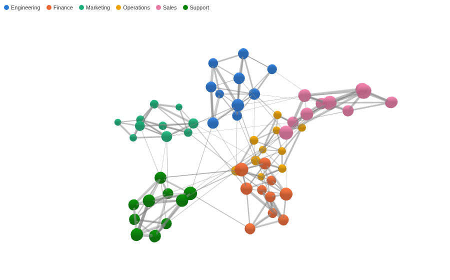

#  3D Force Graph

A network of links between things, laid out in three dimensions: each record links a Source value to a Target value, and a force layout pulls linked nodes together and pushes the rest apart, so groups that are closely connected form clusters. Turn, zoom and click the graph with the mouse.

## Use case

Who talks to whom, which accounts pay which, which products are bought together, which pages link to which. A third dimension gives a dense network more room than a flat layout, so clusters and the few nodes that join them stand out.

## Data

One record per link, with a field for each end (for example From and To) and optionally a figure for the link (for example a number of messages). Omniscope aggregates by Source and Target, so several records for the same pair become one link with their total. Nodes are the values of both fields. The view draws up to 3,000 nodes and 10,000 links.

## Settings

- **Source**, **Target**: the two ends of each link, for example From and To.
- **Link width** (optional): the thickness of each link, for example the sum of Messages. If it is empty, links are thin lines.
- **Node colour** (optional): colours each node by a category of its Source records, for example Team. A node that only appears as a Target has no category and is grey.
- **Background colour** (optional): any CSS colour, for example `#ffffff` or `black`. If it is empty or not a colour, the background is white. The key's text turns light on a dark background.
- **Pane X**, **Pane Y** (optional): one graph per value, side by side or one above the other.

Colours follow the category's name, not its rank, so filtering the report does not recolour the nodes. A key at the top left lists up to 10 categories, when there is room for it. A node's size grows with its number of links.

## Interaction

- Drag to turn the graph, scroll to zoom, right-drag to move it.
- Hover a node for its name, category and number of links; hover a link for its two ends and its Link width figure.
- Click a node to select every record where it is the Source or the Target; its links and neighbours stay highlighted and the rest fades. Click a link to select that pair. Click the same node or link again, or the background, to clear the selection.

The layout runs when the data changes and then stops, with the camera framing the whole graph. Resizing the view, selecting or changing the colours keeps the layout as it is.

## Third-party libraries

Loaded from the jsDelivr CDN when the view opens, so the browser showing the report needs internet access and WebGL:

- [3d-force-graph](https://github.com/vasturiano/3d-force-graph) 1.80.2, MIT licence. Its bundle includes [three.js](https://threejs.org) (MIT licence) and its force layout (d3-force-3d, MIT licence).

The sample data in `sample-data/` is invented for the demo.
