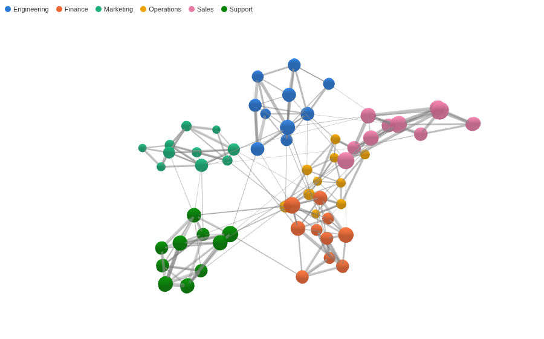
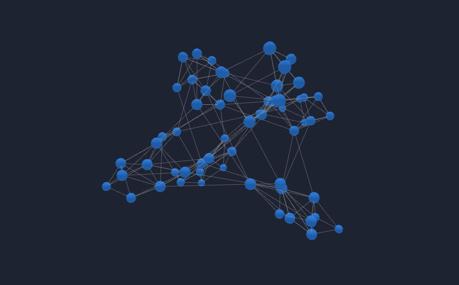
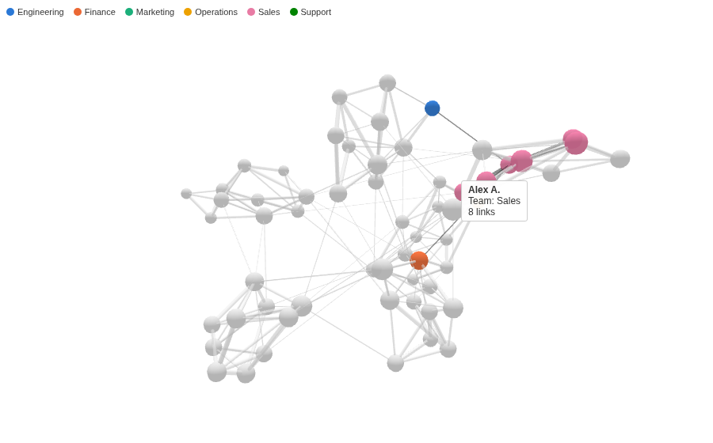

# 3D Force Graph

A network you can turn in your hand. Links between people, accounts or products, laid out in three dimensions so the clusters and the nodes that join them stand out.

## The problem it solves

A table of links (who messaged whom, which account paid which) hides the shape of the network: which groups are closely knit, and which few people or accounts connect them. A flat network drawing shows the shape, but a dense one turns into a knot where lines cross.

The 3D Force Graph lays the network out in three dimensions. Linked nodes pull together and the rest push apart, and the third dimension gives the clusters room. In the illustrative company above (a month of invented messages between 60 people), each team forms its own cluster, and a few people sit between them. Without colours the clusters still show, because people who message each other often pull together:

## Where it earns its place

Omniscope's built-in Force Graph and Network views draw a network flat, with more options for layout and labels, and are better integrated with the report. Use this view when the network is dense enough for a flat drawing to knot, or when turning the graph to see a cluster from another side helps.

The examples below are illustrative.

| Team | Source, Target | Link width | Node colour |
|---|---|---|---|
| HR, management | Sender, recipient | Messages | Team |
| Finance, fraud | Paying account, receiving account | Amount | Account type |
| Retail | Product, product bought with it | Baskets | Category |
| Web | Page, linked page | Clicks | Section |

## How to use it in Omniscope

1. Bring the data into a workflow, one record per link, and connect it to a Report block.
2. Add a view and choose **3D Force Graph**.
3. Set **Source** and **Target**, for example From and To, and optionally **Link width** (for example the sum of Messages) and **Node colour**.
4. Drag to turn the graph and scroll to zoom.
5. Click a person to select their messages in the rest of the report, for example a table of messages.

## Why do this in Omniscope

- **Links from the workflow's data.** Each link is a Source and Target pair from the report's own query, with its messages summed by Omniscope's engine, so the graph follows every filter and matches a table of the same pairs.
- **Node to records.** A click on a person selects every message they sent or received, so the other views of the report show just that person's traffic.
- **Teams keep their colours.** Each team keeps its colour whatever the filters, so a filtered graph compares with the whole.
- **A layout of your own.** The view is one HTML file using an open-source graph library; in the View Designer you can change node sizes, add labels or tune the forces.

## Data and options

One record per link; up to 3,000 nodes and 10,000 links.

| Option | What it does |
|---|---|
| Source, Target | The two ends of each link |
| Link width | Link thickness from a measure |
| Node colour | Category colour of each Source node, with a key |
| Background colour | Any CSS colour |
| Pane X, Pane Y | One graph per value |

## Tested

Mock harness in headless Chromium with software WebGL: the graph renders (checked from a screenshot), 60 people and 216 links, the colour key, the hover label of a node (team and number of links), selecting a person (records where they are Source or Target), clearing by clicking again and by clicking the background, filtering to one team (36 links, colours unchanged), a background colour that is not a colour, a dark background, a 200 by 150 pane, 10,000 links between 2,000 people, more than 3,000 nodes (refused with a message), empty data and unset options.

