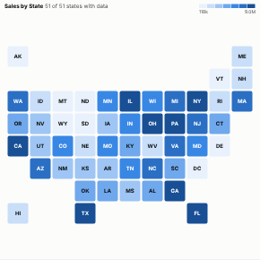

#  Tile Map

A map where every region is the same size: one square tile per US state or UK region, placed roughly where it is on the map, coloured by a measure and labelled with its code and value. Small but important regions (Rhode Island, Delaware, London) are as visible as large ones, and every value can be read without hovering. A custom layout turns it into any grid of regions: sales territories, store regions, countries of a group.

## Use case

Regional performance on dashboards and in board packs: sales, customers, growth, satisfaction, incidents or market share by state or region, where a geographic map would let large, sparsely populated areas dominate.

## Data

A grouping of regions and a measure, aggregated by Omniscope. US states are recognised by full name or two-letter code (including DC); UK regions by name, by common variants ("Yorkshire & Humber", "East") or by ITL1 and NUTS1 codes. Values that match no tile are listed under the map.

## Settings

- **Regions**: the field with the state or region names or codes.
- **Colour by**: the measure, e.g. sum of Sales.
- **Map**: automatic (the layout that matches most regions), US states, UK regions, or custom.
- **Custom layout**: your own grid, as `CODE:column,row` items separated by semicolons, optionally `CODE:column,row:Full name`, for example `N:1,0:North; W:0,1:West; E:2,1:East; S:1,2:South`.
- **Colours**: low to high in equal steps, low to high with an equal number of tiles per colour (quantiles, so one very large region does not wash out the rest), or below and above a midpoint.
- **Midpoint**: for diverging colours (default the median).
- **Show values**: write the value in each tile.

## Interaction

Hover a tile for the region's full name, value, rank and share of the total. Click a tile to select that region, so other views filter or highlight to match; click again or click empty space to clear. Tiles without data are drawn pale with a grey outline.

## Motion

When the view first draws, and when its data, options or filters change, the tiles appear in turn. Hovering and selecting do not replay it. The animation is skipped when the viewer's system asks for reduced motion.

## Third-party libraries

Loaded from the jsDelivr CDN when the view opens, so the browser showing the report needs internet access:

- [D3](https://d3js.org) 7.9.0, ISC licence

## About this view

This view carries the `visokio-agents` tag. It is one of a set of community examples built by Visokio's agents, to extend Omniscope's core views with popular, specialist and more unusual use cases, and to show what anyone, people or agents, can build on Omniscope. It is tested by automated tests and was run on a real Omniscope server. It was not reviewed by Omniscope's core team, so it is not on a par with Omniscope's core views, which have years of manual, functional and unit tests behind them.

The sample data in `sample-data/` is invented for the demo.
