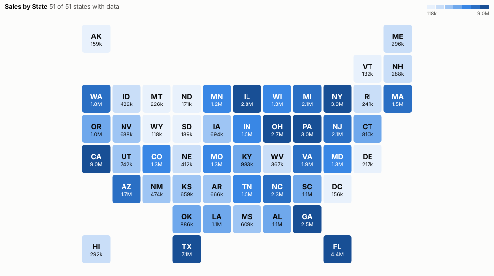
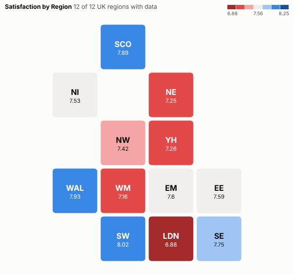
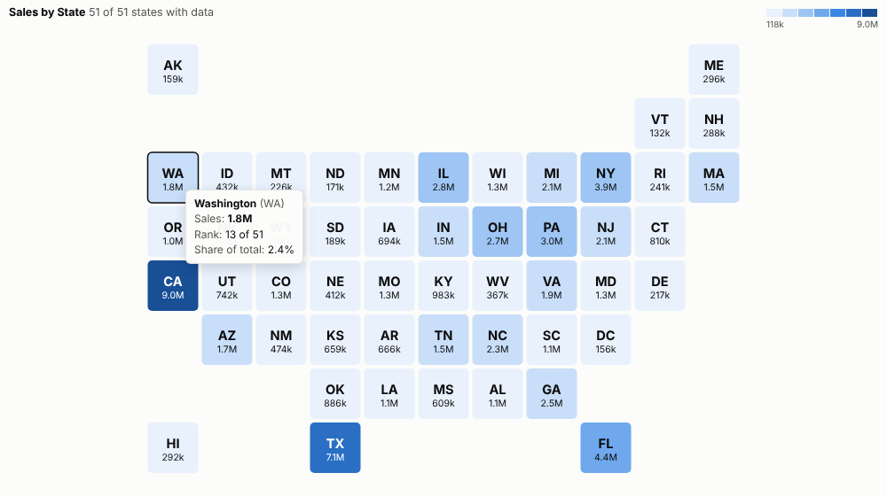
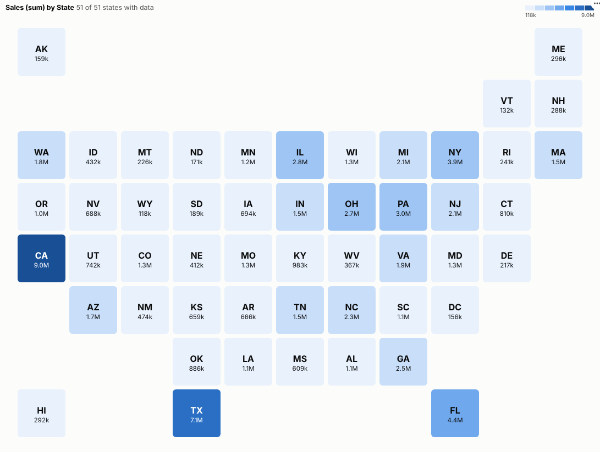

# Tile Map

Every region gets a fair share of the picture. One tile per US state or UK region, coloured by any measure and labelled with its value, for regional reporting that reads at a glance.

## The problem it solves

Geographic maps can be a poor way to compare regions. On a map of the United States, Montana covers more of the screen than New Jersey, Rhode Island and Delaware combined, though it has a fraction of their population; on a map of the UK, London is a speck. Readers end up judging regions by their area rather than by their value. Tile maps avoid this: every region is the same size, in roughly the right place, with its label and value written in.

The Tile Map view draws them from any regional data. In the illustrative sales above, coloured so that every shade holds the same number of states, the large states stand out, and so do the small north-eastern states, which a geographic map would shrink to slivers. The same view works for the UK regions:

## Where it earns its place

The examples below are illustrative.

| Team | Regions | Measure |
|---|---|---|
| Sales | US states, UK regions | Revenue, growth, pipeline |
| Customer experience | Regions | Satisfaction, complaints |
| Operations | Regions or territories (custom layout) | Delivery times, incidents |
| Public sector | Regions | Service use, outcomes |
| Marketing | States | Campaign reach, conversion |

## How to use it in Omniscope

1. Bring regional data into a workflow with a state or region field.
2. Connect it to a Report block, add a view and choose **Tile Map**.
3. Set **Regions** and **Colour by**; the layout is chosen automatically.
4. Use quantile colours if one region dominates, or diverging colours around a target.
5. For your own territories, type a **Custom layout**.

## Why do this in Omniscope

- **Regions recognised, mismatches shown.** State names, two-letter codes, UK region names and ITL1 or NUTS1 codes from the workflow are matched to tiles, and values that match none are listed under the map rather than dropped.
- **State totals that reconcile.** The tests check the totals against the source data, and a click sends the original region name back as the filter, so the other views select the same records.
- **Your own territories.** A custom layout setting turns it into any grid of sales or store regions; the US and UK layouts are plain tables in the view's code, so another country's grid can be added.

## Data and options

A region grouping and a measure.

| Option | What it does |
|---|---|
| Regions | State or region names or codes |
| Colour by | The measure |
| Map | Automatic, US, UK or custom |
| Custom layout | Your own grid |
| Colours | Equal steps, quantiles or diverging |
| Midpoint | Centre for diverging colours |
| Show values | Values in the tiles |

## Tested

- Mock harness: state totals checked against the source data, US and UK layouts recognised, a custom layout, values that match no layout, hover, selection (the original region name is sent back as the filter), clearing, filtering to one month, a small pane, empty data and unconfigured options.
- Real Omniscope server: installed through the Edit View API and configured in a report.

