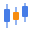
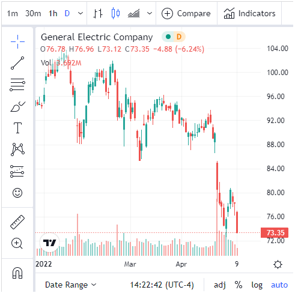

#  TradingView

Shows TradingView's Advanced Real-Time Chart for a stock, index, currency or crypto symbol taken from your data: price bars, volume, date ranges and TradingView's drawing and indicator tools. The symbol changes as the viewer filters the report or selects a record in another view.

## Use case

Beside a portfolio, watch list or trade blotter: select a holding in a table and see its market chart, with your own figures (holding, profit, exposure) in the views around it.

## Data

A field with TradingView symbols, best written with the exchange: `NASDAQ:AAPL`, `NYSE:KO`, `EURONEXT:AIR`, `BINANCE:BTCUSDT`. A bare ticker (`AAPL`) is passed to TradingView as it is. Not every exchange can be shown in TradingView's widgets: for some (London and Tokyo listings, for example) the chart says "This symbol is only available on TradingView". TradingView's [list of markets](https://www.tradingview.com/widget-docs/markets/) shows what its widgets cover.

## Settings

- **Symbol**: the field, with a function that gives one value. With **Singleton** (the usual choice) a chart shows when the filter or a selection leaves one symbol (one record, or several with the same symbol), and a message asks you to pick one otherwise. **Min** or **Max** always show one chart.
- **Bar interval**: what each bar covers when the chart opens, from 1 minute to 1 month (default 1 day). The viewer can change it in the chart.
- **Show details panel**: a panel beside the chart with the symbol's key figures. TradingView hides it in a narrow view.
- **Dark mode**: TradingView's dark theme.
- **Pane X / Pane Y** (optional): one chart per value of a field, side by side or one above the other.

The view shows a message instead of a chart when no field is set, when the field gives a count, when the value is not a symbol, when the view is under 200 by 160 pixels, and when TradingView's script can't be loaded (for example on a network that blocks it). TradingView itself reports a symbol it doesn't know.

## Interaction

The chart is TradingView's widget: zoom, scroll, change the interval and add indicators in it. The "chart by TradingView" link under it, which TradingView's embed code carries, opens the symbol on TradingView. A click elsewhere in the view clears the selection in the report. A resize doesn't reload the chart.

## Market data and privacy

The data comes from TradingView, not from your report: TradingView's widget documentation says stock prices in its widgets are delayed and currency and crypto prices are real time. The viewer's browser loads the chart from TradingView's servers. TradingView says its widgets set no cookies and that it records the address of the embedding page, the widget type, the symbol and the viewer's IP address. Only the symbol is taken from your data.

## Third-party libraries

- **TradingView Advanced Real-Time Chart widget**, loaded at run time from `https://s3.tradingview.com/external-embedding/embed-widget-advanced-chart.js`, as in TradingView's embed code. It is TradingView's free widget service, not an open-source library, used under TradingView's terms of use; its widget FAQ asks you to contact TradingView before removing or changing the attribution link. The view loads it only when there is a symbol to show. This repository only holds the view's code; whoever puts the view in a report uses the widget, so check that your use (for example in a commercial or paid-for report) is allowed by TradingView's terms.
