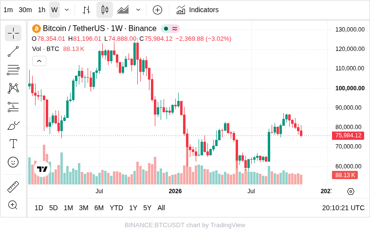
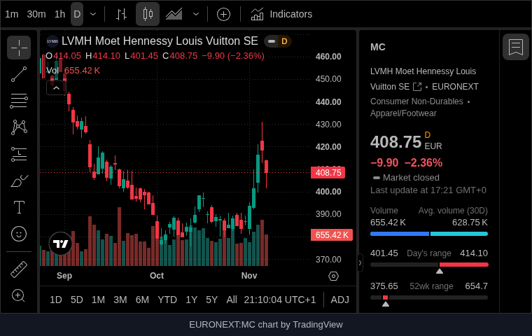

# TradingView

A market chart for the symbol in your data. TradingView's Advanced Real-Time Chart, driven by the record the viewer filters or selects in the report.

## The problem it solves

A portfolio, watch list or trade blotter in a report holds your own figures: holdings, weights, profit, exposure. The market's view of each symbol, its price history and volume, lives elsewhere, and looking it up means leaving the report.

The TradingView view puts TradingView's interactive chart in the report and takes its symbol from your data. With the Singleton function the chart follows the record the viewer selects or filters to; the chart above uses Min, so it always shows the alphabetically first symbol of an invented portfolio (`BINANCE:BTCUSDT`), with weekly bars. Below, one symbol filtered in the report, in dark mode with the details panel:

## Where it earns its place

The examples below are illustrative.

| Team | Data | The chart shows |
|---|---|---|
| Investment | Holdings with weights and returns | The selected holding's price history |
| Treasury | Currency exposures | The rate for the selected currency pair |
| Research | A coverage list with analysts' ratings | The covered stock's chart beside the rating |
| Sales | Accounts that are listed companies | The account's share price |

## How to use it in Omniscope

1. Bring the data into a workflow with a field of TradingView symbols (`NASDAQ:AAPL`, `EURONEXT:AIR`, `BINANCE:BTCUSDT`), and connect it to a Report block.
2. Add a view and choose **TradingView**.
3. Set **Symbol** to that field, with the **Singleton** function.
4. Add a table of the holdings next to it; select one and the chart shows it.
5. Optionally choose the **Bar interval**, and tick **Dark mode** or **Show details panel**.

## Why do this in Omniscope

- **Your figures and the market's, together.** The chart sits next to the holdings table and follows its selection, so the viewer reads a position and its price history without leaving the report.
- **The symbol comes from the workflow.** Build or clean the symbol (add the exchange prefix, map internal codes to listings) in the workflow; the view charts whatever the data says.
- **A view you can change.** It is a short custom view; in the View Designer you can pass TradingView more of its widget settings, such as letting the viewer change the symbol or hiding the drawing toolbar.

## Data and options

A field with TradingView symbols, best with the exchange prefix.

| Option | What it does |
|---|---|
| Symbol | The field, with Singleton (a chart when the selection or filter leaves one symbol), or Min or Max (always one) |
| Bar interval | 1 minute to 1 month; default 1 day |
| Show details panel | The symbol's key figures beside the chart |
| Dark mode | TradingView's dark theme |
| Pane X, Pane Y | One chart per value of a field |

The market data is TradingView's: stock prices in its widgets are delayed, and some exchanges (London and Tokyo listings, for example) can't be shown in widgets at all.

## Tested

- Mock harness, with a stand-in for TradingView's script: the settings passed for each option, the attribution link, filtering to another symbol, several records (a message), a click on the view (clears the selection), a resize (the chart is not reloaded), the interval changed, text that isn't a symbol, TradingView's script unreachable, a 180 by 120 pane, 20,000 records, empty data and no field.
- TradingView's real widget, loaded in the same harness: every symbol in the sample portfolio, the details panel and dark mode.
