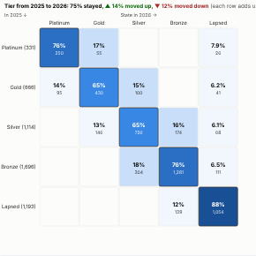

#  Transition Matrix

How items move between states from one period to the next: customers between loyalty tiers, loans between credit ratings, accounts between segments, patients between care levels. Rows are the state in the earlier period, columns the state in the later one, and each cell is the share of its row. The diagonal (no change) is outlined; with the states put in order, the headline gives the share that stayed, moved up and moved down. Items that appear or disappear between the periods get their own row and column.

## Use case

Customer tier and RFM segment migration, credit rating migration and risk grade movement, employee performance ratings between reviews, product lifecycle stages, subscription plan changes, any "where did they go?" question between two snapshots.

## Data

Snapshots: one row per item per period with its state, for example Customer, Year, Tier. The view runs one aggregated query (item by period by state). If an item has several states in one period, the most frequent is used. Filters from other views apply.

## Settings

- **Items**: what moves, e.g. Customer.
- **Periods**: when the state was recorded, e.g. Year.
- **State**: e.g. Tier.
- **From**, **To**: the periods to compare, as they appear in the data (default the last two).
- **Order**: the states best first, separated by commas (for example `Platinum, Gold, Silver, Bronze, Lapsed`). With an order the view counts moves up and down and lays the matrix out in that order; without one, states are sorted by name.

## Interaction

Hover a cell for its count and share. Click a cell to select the items that made that move (up to 3,000), so other views show who they are; click again or click empty space to clear.

## Motion

When the view first draws, and when its data, options or filters change, the matrix cells appear in turn. Hovering and selecting do not replay it. The animation is skipped when the viewer's system asks for reduced motion.

## Third-party libraries

Loaded from the jsDelivr CDN when the view opens, so the browser showing the report needs internet access:

- [D3](https://d3js.org) 7.9.0, ISC licence

## About this view

This view carries the `visokio-agents` tag. It is one of a set of community examples built by Visokio's agents, to extend Omniscope's core views with popular, specialist and more unusual use cases, and to show what anyone, people or agents, can build on Omniscope. It is tested by automated tests and was run on a real Omniscope server. It was not reviewed by Omniscope's core team, so it is not on a par with Omniscope's core views, which have years of manual, functional and unit tests behind them.

The sample data in `sample-data/` is invented for the demo.
