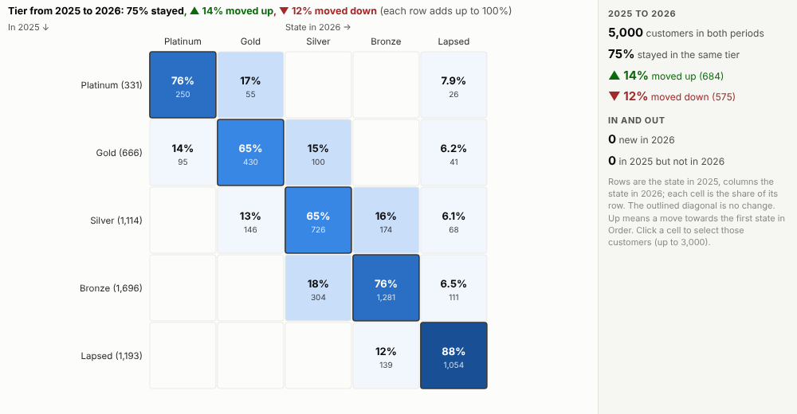
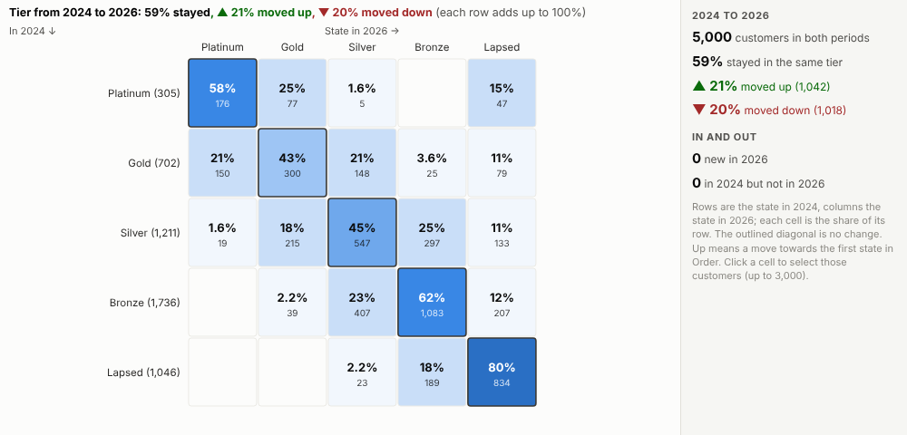
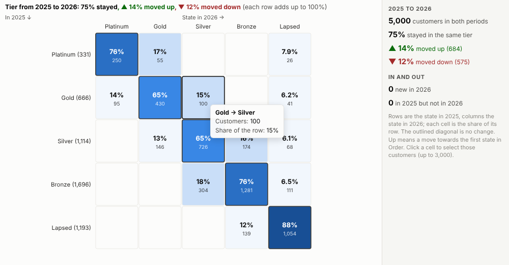
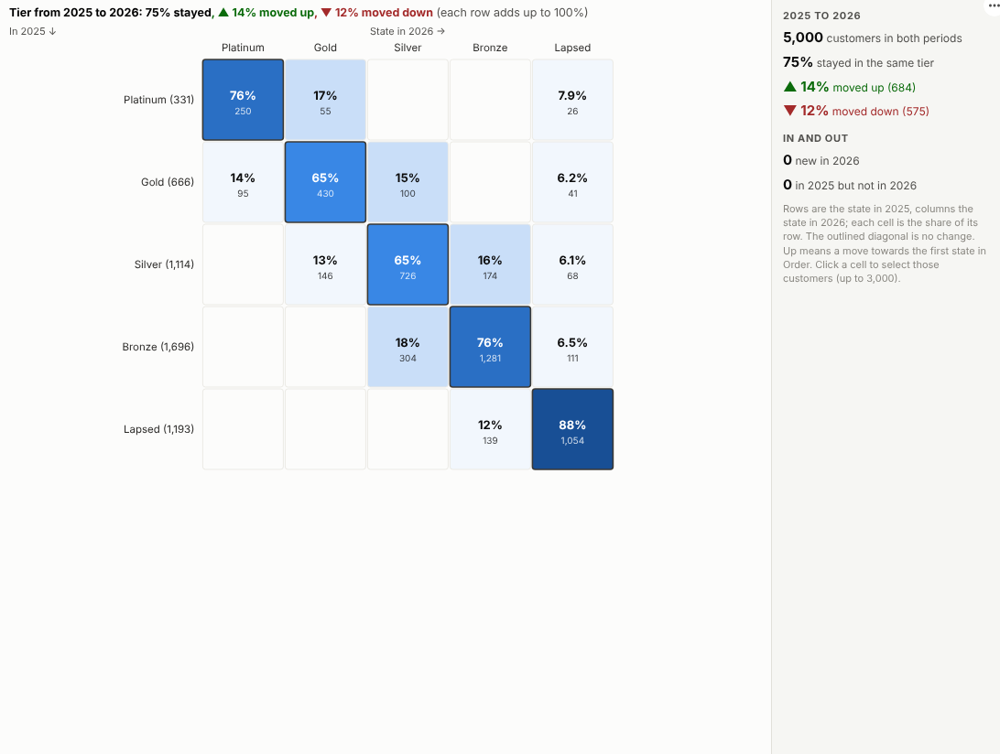

# Transition Matrix

Where did they go? See how customers, accounts or loans moved between tiers, segments or ratings from one period to the next, and who made each move.

## The problem it solves

Snapshot reports say how many customers are in each tier this year and last year, but not who moved where. A stable total can hide a lot of churn: many customers moving down, balanced by others moving up. Risk teams have long used rating migration matrices for exactly this reason, and marketing teams need the same view of loyalty tiers and segments. Building one usually means joining two snapshots by hand.

The Transition Matrix view builds it from the snapshots directly. In the illustrative loyalty programme above, three quarters of customers stayed in their tier between 2025 and 2026, 14% moved up and 12% moved down; Platinum held 76% of its customers. Over two years more have moved:

## Where it earns its place

The examples below are illustrative.

| Team | Items | States |
|---|---|---|
| Marketing and CRM | Customers | Loyalty tiers, RFM segments |
| Credit risk | Loans, borrowers | Ratings, risk grades, arrears status |
| HR | Employees | Performance ratings, grades |
| Product | Accounts | Plans, lifecycle stages |
| Healthcare | Patients | Care levels, risk groups |

## How to use it in Omniscope

1. Bring the snapshots into a workflow: one row per item per period with its state (append yearly or monthly extracts).
2. Connect it to a Report block, add a view and choose **Transition Matrix**.
3. Set **Items**, **Periods** and **State**, and type the states best first in **Order**.
4. Choose **From** and **To** to compare other periods.
5. Click a cell, for example Gold to Silver, to select those customers and look at them in other views.

## Why do this in Omniscope

- **Appended extracts, paired automatically.** Append each year's snapshot in the workflow and the view pairs every item's states across the two periods itself, with no joins by hand.
- **Moves counted, and checked.** Stayed, moved up, moved down, new and gone in one picture, with the counts checked in the tests against an independent calculation.
- **One click from a move to the people.** Clicking Gold to Silver selects those customers (up to 3,000) for the other views.
- **Current with each snapshot.** A new extract appended in the workflow updates the matrix on refresh, and From and To pick any two periods.
- **Weight moves by value.** Cells count items; for a loan book where balances matter, the aggregation is in the view's open source to change.

## Data and options

One row per item per period with its state.

| Option | What it does |
|---|---|
| Items, Periods, State | What moves, when, and where |
| From, To | The periods compared |
| Order | States best first, for moves up and down |

## Tested

- Mock harness: stayed, moved-up and cell counts checked against an independent calculation, periods two years apart, unordered states, items that appear or disappear, hover, selection, clearing, filtering to one region, a narrow layout, a single period, empty data and unconfigured options.
- Real Omniscope server: installed through the Edit View API and configured in a report.

