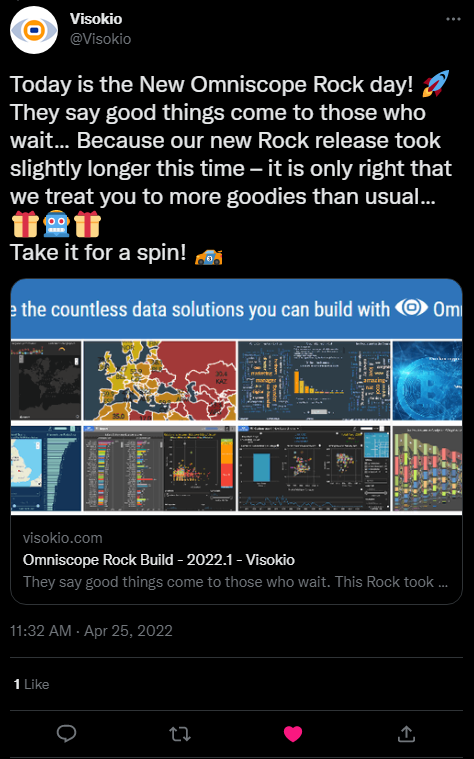

#  Twitter View

Shows a post from X (formerly Twitter) in a report, embedded with X's own post widget. The view takes the post's ID or URL from a field in your data, so the post changes as the viewer filters the report or selects a record in another view.

## Use case

Next to a table or chart of social media activity: the post behind a spike in mentions, the post a campaign row refers to, or the post a support case started from.

## Data

A field with each post's ID (`463440424141459456`) or its URL (`https://x.com/<account>/status/<id>`; twitter.com URLs work too).

Keep post IDs in a **Text** field. They have up to 19 digits, more than a number field can hold exactly: as a number, `463440424141459456` becomes `463440424141459460` and points at the wrong post. The view spots IDs that have lost digits and says so. URLs avoid the problem.

## Settings

- **Post ID or URL**: the field, with a function that gives one value. With **Singleton** (the usual choice) a post shows when the filter or a selection leaves one post (one record, or several with the same value), and a message asks you to pick one otherwise. **Min** or **Max** always show one post.
- **Dark mode**: light text on a dark background, for the post and the view around it.
- **Hide conversation**: show only the post, without the post it replies to.
- **Hide photos and link previews**: show the post's text only.
- **Pane X / Pane Y** (optional): one post per value of a field, side by side or one above the other.

The view shows a message instead of a post when no field is set, when the field gives a count or a total, when the value is not a post ID or URL, when the view is under 220 pixels wide (posts are 250 to 550 pixels wide), and when X's script or the post can't be loaded (deleted or private posts, or a network that blocks X).

## Interaction

The post is X's widget: links in it open on X. A click elsewhere in the view clears the selection in the report. A resize doesn't reload the post.

## Privacy

The viewer's browser loads the widget and the post from X's servers (`platform.x.com` and the hosts it uses), so X receives the viewer's IP address, the address of the page and, where the browser allows it, X's own cookies. The view asks X not to use the post or the page for personalised suggestions and ads (the widget's `dnt` setting). Your report's data is not sent: only the post ID.

## Third-party libraries

- **X for Websites** (`widgets.js`), X's embedding script, loaded at run time from `https://platform.x.com/widgets.js`, the address in X's documentation. It is X's service, not an open-source library, and is used under X's terms for embedded posts. The view loads it only when there is a post to show.
