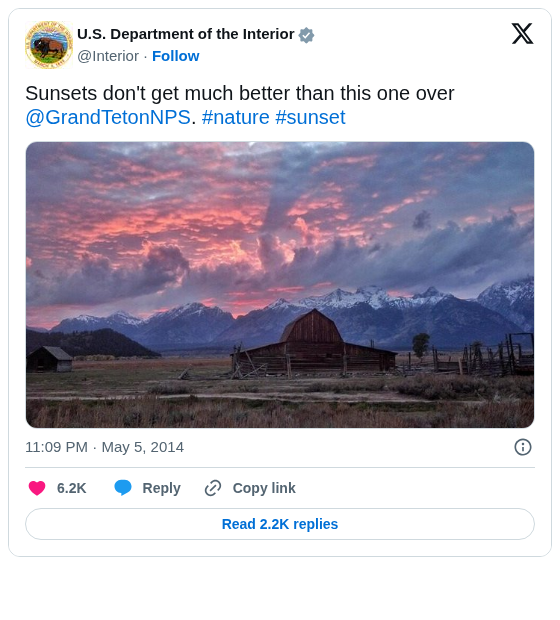
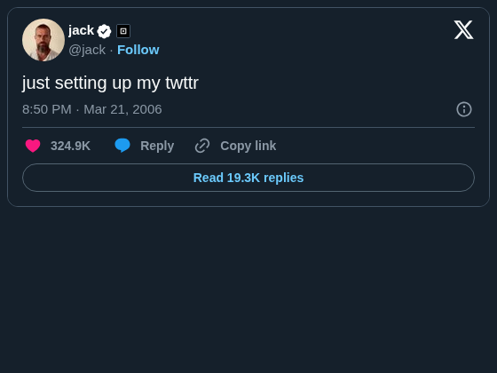

# Twitter View

The post behind the number. Embeds a post from X (formerly Twitter) in a report, chosen by the record the viewer filters or selects.

## The problem it solves

Social media data arrives in a workflow as rows: post IDs or URLs with dates, mentions, campaign tags and engagement counts. A table or chart of those rows shows which post stands out; it doesn't show the post. Opening it means copying an ID into a browser.

The Twitter View shows the post itself, as X's own widget, next to the views that make it interesting. Its Post ID or URL setting reads one value from the data: with the Singleton function, a post appears when the viewer filters or selects one post in another view. The post above uses the Min function instead, so one post always shows; below, a post chosen by its ID, in dark mode with the conversation and media hidden. Both are posts that X's developer documentation uses as examples.

## Where it earns its place

The examples below are illustrative.

| Team | Data | The post shows |
|---|---|---|
| Marketing | Campaign posts with engagement figures | The post a row refers to |
| Communications | Mentions of the organisation by day | The post behind a spike |
| Customer service | Cases opened from social media | The post the case started from |
| Research | A coded sample of posts | Each post next to its codes |

## How to use it in Omniscope

1. Bring the data into a workflow with a field of post IDs (as **Text**) or post URLs, and connect it to a Report block.
2. Add a view and choose **Twitter View**.
3. Set **Post ID or URL** to that field, with the **Singleton** function.
4. Add a table or chart of the posts next to it. Select or filter to one post there, and the Twitter View shows it.
5. Optionally tick **Dark mode**, **Hide conversation** or **Hide photos and link previews**.

## Why do this in Omniscope

- **Next to the analysis.** The post appears in the same report as the figures about it, and changes with the viewer's filter or selection; nobody copies an ID into a browser.
- **IDs that stay right.** Post IDs are too long for a number field; the view reads them from text or from URLs, and says so when an ID has already lost digits rather than showing the wrong post.
- **A view you can change.** It is a custom view of about 200 lines: in the View Designer you can add, say, a row of the post's figures above it, or show several posts at once.

## Data and options

A field with post IDs (as text) or post URLs.

| Option | What it does |
|---|---|
| Post ID or URL | The field, with Singleton (a post when the selection or filter leaves one), or Min or Max (always one) |
| Dark mode | Light text on a dark background |
| Hide conversation | Only the post, not the one it replies to |
| Hide photos and link previews | The post's text only |
| Pane X, Pane Y | One post per value of a field |

## Tested

- Mock harness, with a stand-in for X's script: the post chosen from an ID or a URL, the widget settings passed for dark mode, hidden conversation and media, and not personalising; filtering to another post, several records (a message), a click on the view (clears the selection), a resize (the post is not reloaded), an ID stored as a number that has lost digits, text that isn't a post, a post X can't show, X's script unreachable, a 180 by 140 pane, 20,000 records, empty data, no field and a record count instead of a field.
- X's real widget, loaded in the same harness: both posts above, in light and dark mode, and a post that doesn't exist ("Post 1 is not available").
