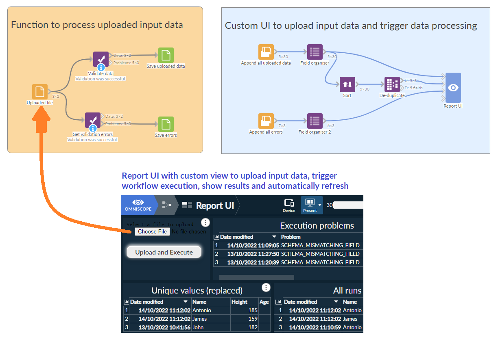

#  Upload and Execute

A file picker and a button in a report: the viewer chooses a file (CSV, Excel, JSON, text and so on), and the view uploads it and executes workflow blocks with it, in a new copy of the project. Report viewers can bring their own data into a validated workflow without access to the workflow.

The view calls the project's [Workflow REST API](https://help.visokio.com/support/solutions/articles/42000073133-workflow-execution-rest-apis): `POST <project>.iox/w/uploadandexecute` with the file and the execution request in one multipart form, then `GET <project>.iox/w/job/<job id>/state` once a second until the job ends, and optionally `POST <project>.iox/w/execute` to refresh this report.

## Use case

- Monthly figures sent in by branches, partners or departments: each upload is validated, appended and shown in the report.
- A checking service: upload a file and see the result of a Validate Data block.

## How to set up the project

The knowledge base article [How to upload a file from the report UI and trigger a workflow execution](https://help.visokio.com/support/solutions/articles/42000100322-how-to-upload-a-file-from-the-report-ui-and-trigger-a-workflow-execution) walks through a complete project. In short:

1. Add a text project parameter, for example `uploadedFile`.
2. In the File block that should read the upload, link its path option to that parameter.
3. Add the blocks that process the file (Validate Data, Batch Append and so on), and the report.
4. Add this view to the report and set **Blocks to execute** to the blocks to run.

[WorkflowAndUI.ioz](WorkflowAndUI.ioz) is an example project with this set-up.

## Data

None: the view does not read the report's data, and filters do not affect it.

## Settings

- **Blocks to execute**: block names separated by commas. Leave empty to execute the whole workflow.
- **Button text**: the text on the button (default "Upload and execute").
- **File parameter** (default `uploadedFile`): the project parameter the uploaded file is given to; link it to the File block's path.
- **Delete the copy when finished** (default on): delete the copy of the project and its execution data when the job ends.
- **Refresh this report when finished** (default on): when the job has finished, execute this report's own block, from source, so the report shows the new data.
- **Show job state** (default on): shows the progress under the button. Errors are shown whether or not this is on.

## Requirements

The viewer's user needs the **Workflow Execution via APIs** permission on the Omniscope server (off by default). Executions started this way run through the server's scheduler, so the server's edition must include it.

## Interaction

Choose a file: its name and size are shown and the button becomes active. Press the button to upload and execute; it stays disabled, with a spinner, until the job ends. If Omniscope reloads the view while the job runs (it does when a block the view reads is executed, or a parameter it reads changes), the view picks the job up again and shows its progress and result. The result stays shown for two minutes after such a reload.

The view has nothing to select. A click on empty space clears the report's selection, as in other views; a click on the file picker or the button does not.

## Related views

[Lambda Workflow Execution](../lambdaworkflowexecution) runs a copy of the project with typed parameter values instead of a file.

## Third-party libraries

None: the view is plain HTML and JavaScript and needs nothing beyond Omniscope's custom view API.
