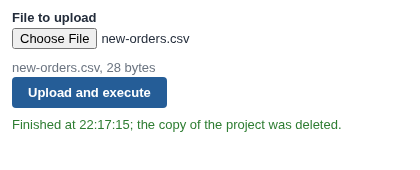

# Upload and Execute

Viewers upload a file from the report, and the workflow checks it, processes it and shows it.

## The problem it solves

Data often arrives as files from people who should not edit the workflow: monthly figures from branches, a partner's price list, survey results. Someone has to put each file where the workflow can read it and run the workflow.

The Upload and Execute view lets the viewer do it from the report: choose a file and press the button. The file goes to the server with the execution request; the workflow runs in a new copy of the project with a project parameter pointing at the file, and the report can refresh itself when it has finished. In the live demo above nothing is uploaded: the Workflow REST API is simulated in the browser.

## Where it earns its place

The examples below are illustrative.

| Team | Upload |
|---|---|
| Finance | Branch returns, checked by a Validate Data block and appended to the year |
| Procurement | A supplier's price list, compared with the last one |
| Research | Survey results, cleaned and added to the dashboard |

## How to use it in Omniscope

1. Add a text project parameter, for example `uploadedFile`, and link a File block's path to it.
2. Build the blocks that check and process the file (for example Validate Data and Batch Append) and the report.
3. Give the users who upload the **Workflow Execution via APIs** permission.
4. In the report, add a view and choose **Upload and Execute**; set **Blocks to execute** and **File parameter**.

## Why do this in Omniscope

- **Checked before it is shown.** The upload runs through the workflow you built, so a Validate Data block can refuse a file with the wrong columns before any view shows it.
- **From file to report in one step.** The same report that takes the file shows the result, refreshed when the run has finished.
- **Adjustable.** The file picker and the upload request are a short block of plain JavaScript; in the View Designer they can be changed to accept only some file types, or to send a second file for a second parameter.

## Data and options

No data is needed; the uploaded file is the data.

| Option | What it does |
|---|---|
| Blocks to execute | Block names; empty runs the whole workflow |
| File parameter | The project parameter that receives the file |
| Delete the copy when finished | Remove the copy and its data afterwards |
| Refresh this report when finished | Re-execute this report from source afterwards |
| Button text, Show job state | Label and progress |

## Tested

Mock harness with a stand-in for the Workflow REST API: the button stays disabled until a file is chosen; the multipart request carries the file under the key named in the execution request, for the parameter set in File parameter; the job followed to Finished, then this report refreshed (or not, as set); a refused permission; filtering (sends nothing); a 150 by 110 pane; empty data; no settings; and a 3 MB file; and a reload of the view in the middle of a run (the view resumes and shows the result).
