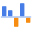
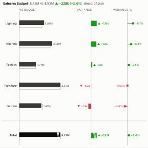

#  Variance Chart

Actual against plan, the way finance teams lay it out in management reports. For every row or period the view shows the actual as a solid bar over the plan as an outline, the absolute variance as a green or red bar, and the percentage variance as a pin, with a total at the end. Periods (dates) are drawn as columns; categories as rows sorted by variance.

## Use case

Monthly management packs and board reporting: sales against budget, costs against cost budget, this year against last year, actuals against forecast, by month, region, product line, cost centre or account.

## Data

Any data with a breakdown and two measures to compare, for example a sales table with a Budget column, or actuals and budget appended into one table in the workflow.

## Settings

- **Breakdown**: the rows or periods, e.g. Region, Product line or Month. Dates are drawn as columns in time order (group the date by month, or use unique values of a month field).
- **Actual**, **Plan**: the two measures, e.g. sum of Sales and sum of Budget, Forecast or Prior year.
- **Above plan is**: good (sales, profit: above plan is green) or bad (costs, delays: above plan is red).
- **Sort**: by variance (best first), by variance %, by actual or as in the data. Periods always stay in time order.
- **Rows shown**: further rows are combined as Other (default 15).
- **Layout**: automatic, rows or columns.
- **Show total**: adds a total; shown only when both measures are sums or counts, since averages cannot be added up.

## Reading the chart

Three panels share the rows or columns. The first compares the actual (solid) with the plan (outline). The second shows the variance, actual minus plan, in green when it is good and red when it is bad; every value carries a sign and an arrow, so it reads without colour. The third shows the variance as a percentage of the plan. The heading states the overall result. The total is drawn on the same scale as the rows when it fits; when it is much larger its bar is cut, marked with a break, and labelled with its value.

## Interaction

Hover a row or period for the actual, plan and variance. Click one to select it, so other views in the report filter or highlight to match; click again or click empty space to clear.

## Motion

When the view first draws, and when its data, options or filters change, the variance bars grow out from zero. Hovering and selecting do not replay it. The animation is skipped when the viewer's system asks for reduced motion.

## Third-party libraries

Loaded from the jsDelivr CDN when the view opens, so the browser showing the report needs internet access:

- [D3](https://d3js.org) 7.9.0, ISC licence

## About this view

This view carries the `visokio-agents` tag. It is one of a set of community examples built by Visokio's agents, to extend Omniscope's core views with popular, specialist and more unusual use cases, and to show what anyone, people or agents, can build on Omniscope. It is tested by automated tests and was run on a real Omniscope server. It was not reviewed by Omniscope's core team, so it is not on a par with Omniscope's core views, which have years of manual, functional and unit tests behind them.

The sample data in `sample-data/` is invented for the demo.
