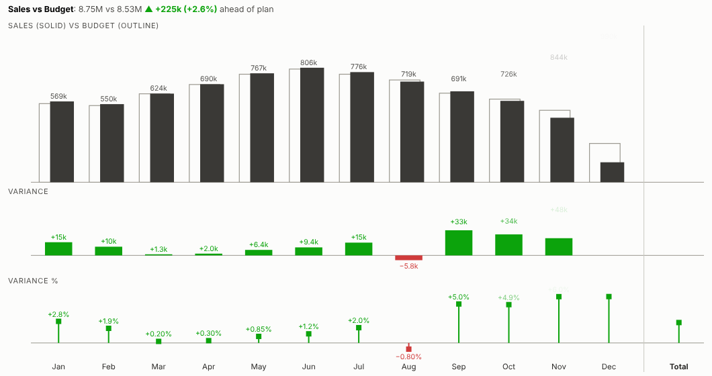
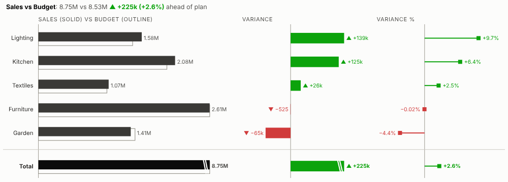
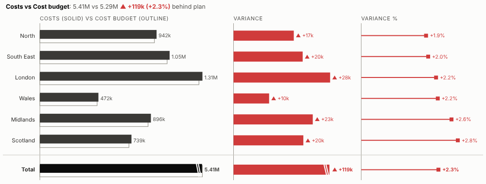
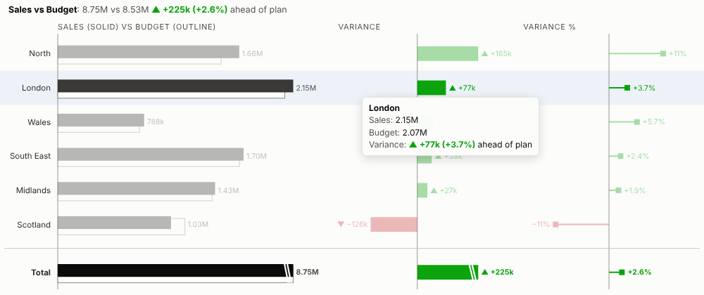
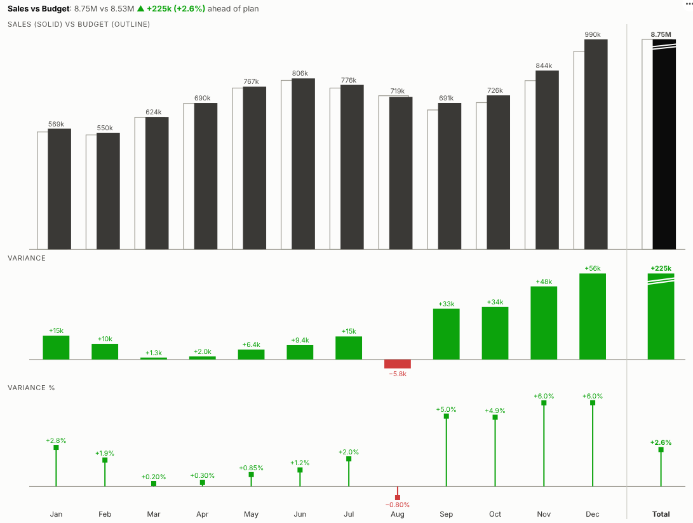

# Variance Chart

Actual against plan, at a glance. Sales against budget, costs against forecast, this year against last, with the variance in money and in percent and the total at the end, in the layout finance teams use in management reports.

## The problem it solves

"How did we do against plan?" is a standard question in a monthly review. The usual answer is a table of actuals, budgets and variances, or a clustered bar chart where the eye has to work out the differences. Neither shows quickly where the business is ahead, where it is behind, and by how much. Finance teams that care about this build careful variance charts by hand in spreadsheets, every month.

The Variance Chart view builds them live in an Omniscope report. Each row or period shows the actual over the plan, the absolute variance and the percentage variance, coloured by whether it is good or bad, with signs and arrows so it reads in black and white too. In the illustrative data above, sales ran ahead of budget in every month except August, and the gap widened in the autumn. Group by product line and the rows sort themselves by variance:

For costs, where spending above plan is bad, the colours swap:

## Where it earns its place

The examples below are illustrative.

| Report | Actual | Compared with |
|---|---|---|
| Monthly management pack | Sales, margin, profit | Budget or forecast |
| Cost-centre review | Spend by cost centre or account | Cost budget |
| Sales performance | Sales by region, team or rep | Target or prior year |
| Operations | Volumes, hours, output | Plan or capacity |
| Service levels | Delays, backlog, complaints | Target (lower is better) |

## How to use it in Omniscope

1. Bring actuals and plan figures into a workflow; append or join them so each row carries both, or keep them side by side as columns.
2. Connect it to a Report block, add a view and choose **Variance Chart**.
3. Set **Breakdown** (e.g. Month or Region), **Actual** and **Plan**.
4. For costs and other measures where above plan is bad, set **Above plan is** to Bad.
5. Click a month or row to select it; other views in the report show what is behind the variance.

## Why do this in Omniscope

- **Actuals and plan from the same workflow.** The two are appended or joined in the workflow and the chart updates when it refreshes, so the monthly pack is ready when the books close.
- **Totals that only add what adds up.** The tests check totals against the source data, and a total is shown only when both measures are sums or counts.
- **Drill without rebuilding.** Filter to a region, channel or product and the variances are recalculated; click a month to show the transactions behind it in the other views.
- **Your management-pack style.** Solid for actuals and outline for plan by default; the colours and panel layout are in the view's HTML and CSS to match your own pack.

## Data and options

A breakdown and two measures.

| Option | What it does |
|---|---|
| Breakdown | Rows or periods (dates become columns) |
| Actual, Plan | The two measures to compare |
| Above plan is | Good or bad, to colour the variances |
| Sort | By variance, variance %, actual or data order |
| Rows shown | Further rows combined as Other |
| Layout | Automatic, rows or columns |
| Show total | Total row, for sums and counts |

## Tested

- Mock harness: totals checked against the source data, sorting, hover, selection, clearing, filtering to one channel, a narrow layout, the Other row, averages (no total), costs where above plan is bad, empty data and unconfigured options.
- Real Omniscope server: installed through the Edit View API and configured in a report with the month as unique values; identical figures.

