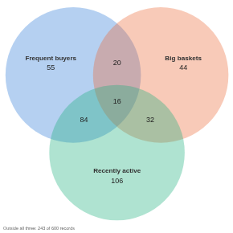

#  Venn Diagram

Three overlapping sets, each defined by a range of a numeric field, with the number of records in each of the seven regions and outside all three. Click a region to select exactly the records in it, so the rest of the report shows, say, the customers who order often and spend a lot but have not ordered recently.

## Use case

Overlaps between three conditions: customers who are frequent, high-spending and recently active; patients over an age, over a weight and over a blood pressure; products with high sales, high margin and high returns. It also works as a visual filter for the other views in a report.

## Data

One record per item (customer, patient, product) with the three numeric fields that define the sets. Any other fields can be used by the other views in the report.

## Settings

For each of the sets A, B and C:

- **Set field**: the numeric field that defines the set.
- **Set min** (optional): the set holds records whose value is **above** this number (not equal to it).
- **Set max** (optional): the set holds records whose value is **at most** this number.
- **Set name** (optional): the name shown in the diagram. If it is empty, the field name is shown.

A set with neither Min nor Max holds every record; the view says so below the diagram. Min and Max are text options, so type a plain number (`80`, `0.5`); thousands separators are ignored.

## How the regions are counted

Each region counts the records that are in its sets and in none of the others: the region shared by A and B only counts records in A and B but not in C. The seven regions and the "outside all three" count add up to the total. Counts follow the report's filters. Hover a region for its count and share of the total.

## Interaction

Click a region to select its records; click it again, or click empty space, to clear the selection. The selection is the same rule as the count, so other views show exactly the records counted.

## Third-party libraries

Loaded from the jsDelivr CDN when the view opens, so the browser showing the report needs internet access:

- [D3](https://d3js.org) 4.13.0, BSD 3-Clause licence

The sample data in `sample-data/` is invented for the demo.
