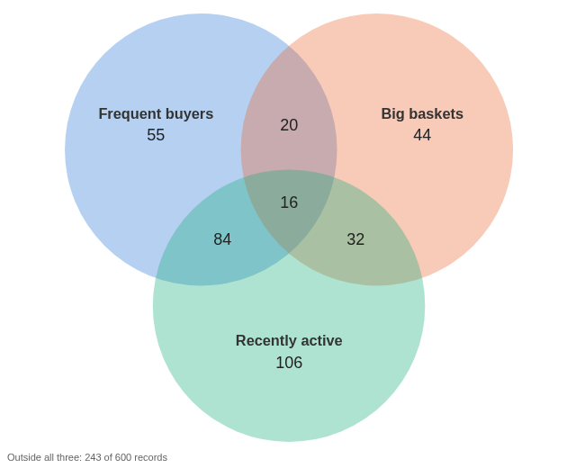
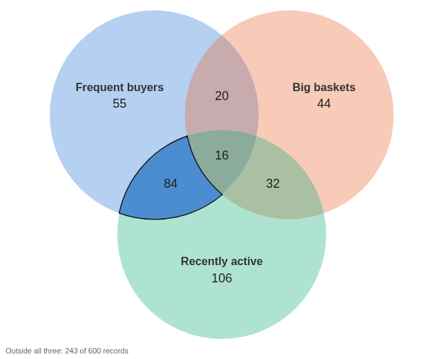

# Venn Diagram

How three conditions overlap, with the count in every region, and a click to select exactly the records in one of them.

## The problem it solves

Questions about customers, patients or products often combine three conditions: who orders often, spends a lot, and has ordered recently? Which of the frequent buyers have gone quiet? A table of filters answers one combination at a time; a Venn diagram shows all seven at once, and how big each is.

The Venn Diagram view defines each set as a range of a numeric field, counts the records in each region and outside all three, and lets you click a region to select its records. In the illustrative customers above (invented figures), 84 customers order often and have ordered in the last 30 days but have small baskets, and 20 order often with big baskets but have not ordered recently: a list worth a call.

## Where it earns its place

Omniscope's filters can select any one of these combinations, but they do not show how the sets overlap or how big each part is. This view does both, and works as a filter for the rest of the report.

The examples below are illustrative.

| Team | Set A | Set B | Set C |
|---|---|---|---|
| Marketing | Orders above 10 | Average basket above 80 | Last order within 30 days |
| Clinical research | Age above 65 | BMI above 30 | Systolic blood pressure above 140 |
| Product | Sales above target | Margin above 40% | Returns above 5% |
| HR | Tenure above 5 years | Rating above 4 | Training hours at most 10 |

## How to use it in Omniscope

1. Bring the data into a workflow, one record per customer (or patient, or product), and connect it to a Report block.
2. Add a view and choose **Venn Diagram**.
3. For each set, choose a numeric field and type a **Min**, a **Max** or both, and optionally a name.
4. Add the views that should follow the selection, for example a table of customers.
5. Click a region to select its records; click again or click empty space to clear.

## Why do this in Omniscope

- **Counted by the engine.** The seven regions and the remainder are counted by Omniscope's query engine and follow the report's filters; the tests check the counts against the source data.
- **Exact selections.** Clicking a region selects the same rule that was counted, so the other views show exactly those records.
- **Thresholds as settings, fields from the workflow.** The three numeric fields can be calculated in the workflow, and changing a Min or Max updates every count, with no formulas to copy down.
- **A set of a different kind.** Each set's filter is built by a short function in the view's script; make one set a category instead of a range in the View Designer.

## Data and options

One record per item with three numeric fields.

| Option | What it does |
|---|---|
| Set A/B/C field | The numeric field that defines the set |
| Set A/B/C min | The set holds values above this (empty: no lower limit) |
| Set A/B/C max | The set holds values up to and including this (empty: no upper limit) |
| Set A/B/C name | The name shown; empty shows the field name |

## Tested

Mock harness: the seven region counts, the remainder and the total checked against the source data, also after filtering to one region; selecting a region (the rule is "in these sets, not in the others"), clicking it again and clicking empty space to clear; the tooltip's count and share; a set with no limits; a 240 by 170 pane; 10,000 records (the regions add up to the total); empty data and unset fields.
