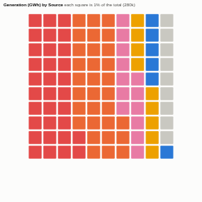

#  Waffle Chart

Part-to-whole as a grid of 100 squares, each worth 1%. Shares are easier to read and compare than in a pie chart: you can count them. Squares are rounded so that they always add up to exactly 100, parts beyond the largest few are combined as Other, and an optional grouping draws one waffle per region, year or segment for side-by-side comparison.

## Use case

Infographics and executive summaries: energy or fuel mix, spend by category, customers by segment, budget allocation, survey answers, workforce composition. Small multiples show how the mix differs between nations, regions or years.

## Data

A grouping of parts and a positive measure, aggregated by Omniscope. Zero and negative values are left out (a waffle shows parts of a positive total).

## Settings

- **Parts**: the parts of the whole, e.g. Source.
- **Size**: the measure, e.g. sum of Generation.
- **One waffle per** (optional): one waffle per value, e.g. Nation (the 12 largest).
- **Parts shown**: the largest parts (default 6); the rest are combined as Other.
- **Squares**: 100 (each 1%) or 400 (each 0.25%).
- **Shape**: squares or dots.

## How the squares are counted

Each part gets its share of the 100 (or 400) squares, rounded with the largest-remainder method so the total is always exact. With small multiples each waffle is 100% of its own total. Colours follow the part's name, so each part keeps its colour whatever the settings or filters.

## Interaction

Hover a square for the part's value and share. Click a square or a key entry to select that part (in a small multiple, that part in that waffle), or a waffle's title to select its group; click again or click empty space to clear.

## Motion

When the view first draws, and when its data, options or filters change, the cells fill in one after another. Hovering and selecting do not replay it. The animation is skipped when the viewer's system asks for reduced motion.

## Third-party libraries

Loaded from the jsDelivr CDN when the view opens, so the browser showing the report needs internet access:

- [D3](https://d3js.org) 7.9.0, ISC licence

## About this view

This view carries the `visokio-agents` tag. It is one of a set of community examples built by Visokio's agents, to extend Omniscope's core views with popular, specialist and more unusual use cases, and to show what anyone, people or agents, can build on Omniscope. It is tested by automated tests and was run on a real Omniscope server. It was not reviewed by Omniscope's core team, so it is not on a par with Omniscope's core views, which have years of manual, functional and unit tests behind them.

The sample data in `sample-data/` is invented for the demo.
