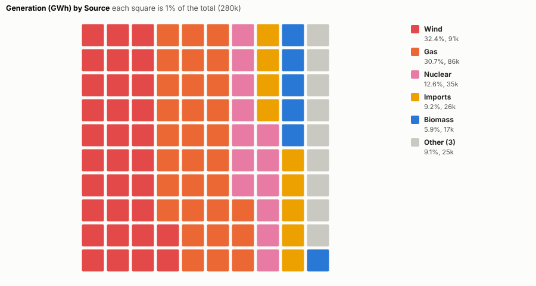
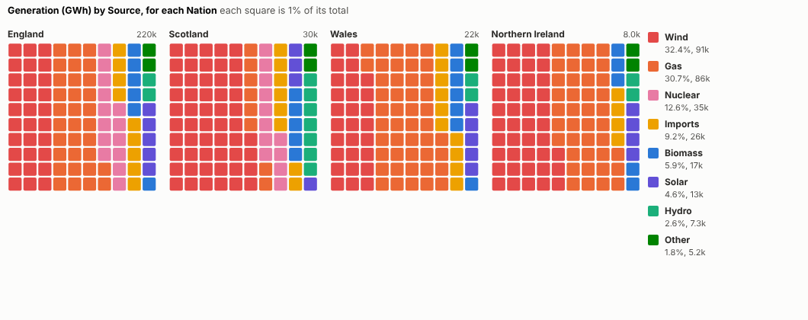
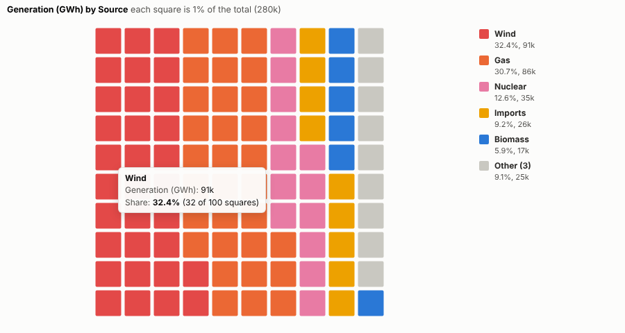
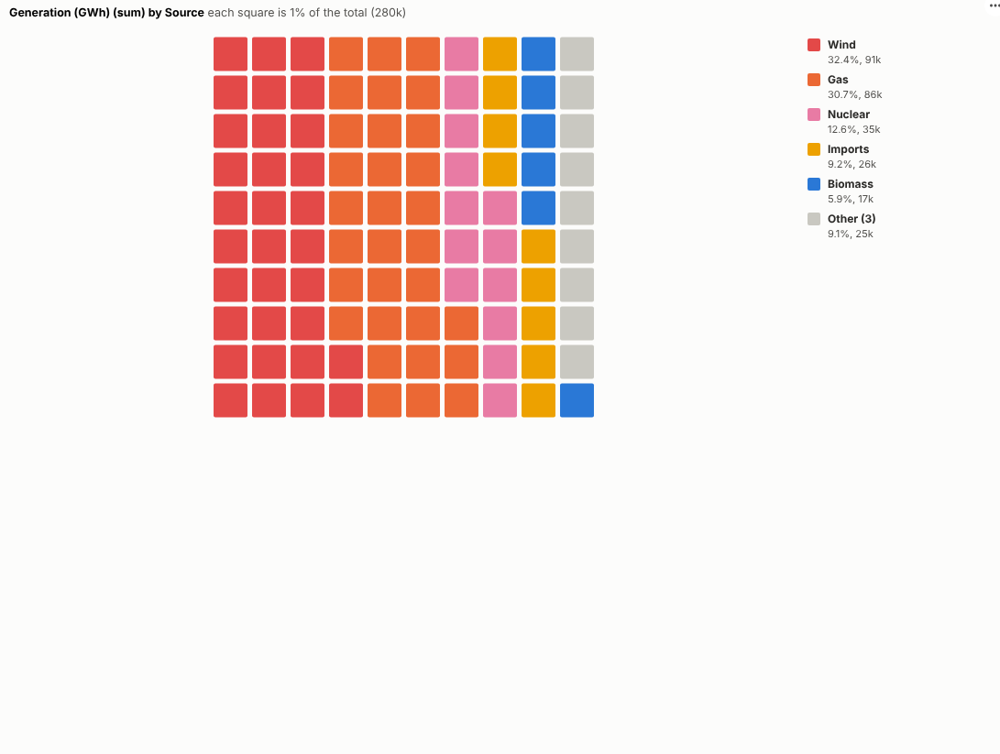

# Waffle Chart

Shares you can count. Part-to-whole as 100 squares, alone or side by side, for summaries that read in a second.

## The problem it solves

Pie charts are the default way to show a mix, and they are hard to read: the eye is poor at comparing angles, and comparing two pies is harder still. Waffle charts show the same thing as a grid of 100 squares, so 32% is 32 squares, and two waffles side by side can be compared square by square. They are a favourite of infographics and annual reports.

The Waffle Chart view draws them from any parts and measure. In the illustrative generation mix above (invented figures), wind and gas make up nearly two thirds of the total. One waffle per nation shows how differently each nation's mix is made up:

## Where it earns its place

The examples below are illustrative.

| Team | Parts | One waffle per |
|---|---|---|
| Energy and sustainability | Generation or fuel source | Site, nation, year |
| Finance | Spend by category | Department, year |
| Marketing | Customers by segment | Region, channel |
| HR | Workforce by contract type | Location, grade |
| Communications | Survey answers | Audience |

## How to use it in Omniscope

1. Bring the data into a workflow with a part field and a measure.
2. Connect it to a Report block, add a view and choose **Waffle Chart**.
3. Set **Parts** and **Size**, and optionally **One waffle per**.
4. Choose 100 or 400 squares and squares or dots.
5. Click a part to select it and see its detail in other views.

## Why do this in Omniscope

- **Shares from the workflow's output.** The parts are aggregated from the data the report already holds, so a refresh redraws every waffle.
- **Exactly 100, every time.** Largest-remainder rounding keeps the squares at exactly 100 (or 400), and the tests check square counts against the source data.
- **Colours tied to parts, clicks tied to records.** Each part keeps its colour in every waffle and through filters, and clicking a part selects its records for the other views.
- **Icons instead of squares.** Squares and dots are the built-in shapes; the drawing code is open if your annual report wants icons.

## Data and options

Parts and a positive measure.

| Option | What it does |
|---|---|
| Parts, Size | What the whole is made of, and how much |
| One waffle per | Optional small multiples |
| Parts shown | Largest parts, the rest as Other |
| Squares | 100 or 400 |
| Shape | Squares or dots |

## Tested

- Mock harness: square counts checked against the source data (always exactly 100), the Other part, small multiples, dots on a 400 grid, hover, selecting a part and the Other part, clearing, filtering to one nation, a small pane, empty data and unconfigured options.
- Real Omniscope server: installed through the Edit View API and configured in a report.

