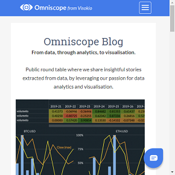

#  Web

Shows a web page inside a report, in a frame. The page's address comes from a field in your data, so the page changes as the viewer filters the report or selects a record in another view.

## Use case

Next to a table of records that point somewhere: a customer's website, a map of a site, a product's data sheet, a ticket in another system's web page. Select a record and its page opens beside it.

## Data

A field with web addresses: `https://...` or `http://...`, a bare host name (`www.example.org/page`, which gets `https://` added), or a path on the Omniscope server (`/Reports/Sales.iox/r/Report/`). Anything else in the field, such as a `javascript:` or `data:` address, is refused with a message.

## Settings

- **Page URL**: the field, with a function that gives one value. With **Singleton** (the usual choice) the page opens when the filter or a selection leaves one record, and a message asks you to pick one otherwise. **Min** or **Max** always show one page.
- **Show address bar** (on by default): a bar above the page with its address and an **Open in a new tab** link. It is hidden when the view is under 120 pixels high.
- **Pane X / Pane Y** (optional): one page per value of a field, side by side or one above the other.

The view shows a message instead of a page when no field is set, when the field gives a count or a total, and when the value is not a web address.

## Pages that stay blank

Many sites don't allow being shown inside another site's page (they send an `X-Frame-Options` or `Content-Security-Policy: frame-ancestors` header), and browsers then show an empty frame or an error page. A browser doesn't tell the page around the frame that this happened, so the view can't detect it: use **Open in a new tab**. Pages made to be embedded, such as OpenStreetMap's embeddable maps (`openstreetmap.org/export/embed.html`), work.

In a report served over `https://`, browsers also block `http://` pages in a frame. The view then shows a message and the Open in a new tab link instead.

## Interaction

The page is fully interactive. It runs in a sandboxed frame: scripts, forms, pop-ups, downloads and dialogs are allowed, but a page from another site can't navigate the report away. A click on the address bar clears the selection in the report. A resize doesn't reload the page, so the viewer doesn't lose their place in it.

## Privacy

The viewer's browser loads the page directly from its site, which sees the viewer's IP address and, as for any link, the address of the Omniscope server (not the report's path). Nothing from the report's data is sent apart from the address itself.

## Third-party libraries

None: the view is plain HTML and JavaScript and needs nothing beyond Omniscope's custom view API. The pages it shows come from wherever their addresses point.

The sample data in `sample-data/` is invented for the demo; its addresses point to real Wikipedia and OpenStreetMap pages.
