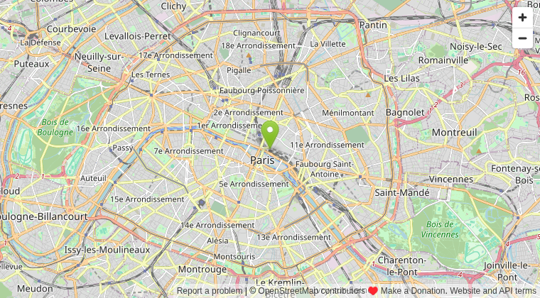

# Web

A web page inside a report, chosen by the data: the page whose address is in the record the viewer filters or selects.

## The problem it solves

Records often point somewhere: a product page, a supplier's site, a map, a document on the intranet, a page of another system. In a table those addresses are just text; following one means leaving the report.

The Web view shows the page itself, in a frame, next to the views that led to it. Its Page URL setting reads one address from the data: with the Singleton function, the page opens when the viewer filters or selects one record. The live demo above uses Min, so it always shows the first of an invented list of offices' Wikipedia articles; below, the offices' OpenStreetMap maps, a kind of page made to be embedded, with the address bar hidden.

## Where it earns its place

The examples below are illustrative.

| Team | Records | The page shows |
|---|---|---|
| Sales | Accounts | The customer's website or the account in a CRM's web page |
| Property | Sites | A map or a street view of the site |
| Procurement | Products | The supplier's product page or data sheet |
| Operations | Incidents | The ticket in the service desk's web page |

Many sites don't allow being shown inside another site's page: they stay blank in the frame. The address bar's **Open in a new tab** link opens them anyway.

## How to use it in Omniscope

1. Bring the data into a workflow with a field of web addresses, and connect it to a Report block.
2. Add a view and choose **Web**.
3. Set **Page URL** to that field, with the **Singleton** function.
4. Add a table of the records next to it; select one and the page opens.

## Why do this in Omniscope

- **The page next to the record.** The page opens in the same report as the data that points to it, and changes with the viewer's filter or selection.
- **Addresses built in the workflow.** A formula in the workflow can build each record's address (a map from coordinates, a search from a product code), so the page follows the data with nothing typed by hand.
- **Only web pages.** The view opens `https://` and `http://` addresses and paths on the Omniscope server, refuses anything else in the data (such as `javascript:`), and keeps pages from other sites from navigating the report away.

## Data and options

A field with web addresses. Addresses without `https://` (`www.example.org`) get it added.

| Option | What it does |
|---|---|
| Page URL | The field, with Singleton (a page when one record is selected), or Min or Max (always one) |
| Show address bar | The address and an Open in a new tab link above the page |
| Pane X, Pane Y | One page per value of a field |

## Tested

- Mock harness, with stand-in pages: the address taken from the data, a bare host name, a path on the same server (and that page trying to navigate the report away: blocked), a `javascript:` address (refused), filtering to another record, several records (a message), a click on the bar (clears the selection), a resize (the page is not reloaded), the address bar hidden and shown, a 160 by 100 pane, 20,000 records, empty data, no field and a record count instead of a field.
- The real pages in the same harness: the Wikipedia article and the OpenStreetMap map above, inside the view's frame.
