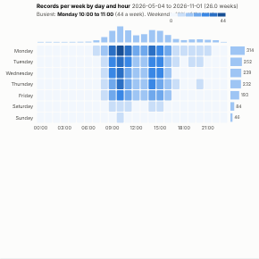

#  Weekly Pattern

When does it happen? A day-of-week by hour-of-day heatmap built from timestamps: calls, orders, visits, logins, incidents, deliveries. Each cell shows the average per week (or the total) for that hour of that weekday, with totals per hour along the top and per day down the side, and a headline naming the busiest hour and the weekend share.

## Use case

Staffing and rota planning in contact centres, stores, clinics and warehouses; scheduling maintenance in quiet hours; timing campaigns and posts; spotting unusual activity (logins at 3am); capacity planning for systems and services.

## Data

One row per event with a date and time. The view runs one aggregated query (the measure per hour, so a year is about 8,800 rows whatever the number of events) and folds the hours into the weekly grid in the browser. Times are used as stored; use **Shift hours** to convert, for example, from UTC to local time. Filters from other views apply.

## Settings

- **Timestamps**: the date and time field. A field with dates only is detected and explained.
- **Measure** (optional): what to count or add up, e.g. sum of Handling minutes (default: number of records). An average measure shows the average across the hours with data.
- **Show**: average per week (default), which makes periods of different lengths comparable, or the total for the period.
- **Shift hours**: shift all times by a whole number of hours.

## Reading the chart

Darker cells are busier. Averages per week divide each cell's total by the number of times that weekday and hour occurs between the first and last record. The bars above show each hour across the whole week, and the bars on the right each day of the week with its value.

## Interaction

Hover a cell or a bar for its value, total and share. Click a cell, a day, an hour or a bar to select the records in it, so other views show, for example, which reasons or channels drive Monday mornings; click again or click empty space to clear. Because a weekday-hour is not a field, the selection is sent as the list of hour ranges it covers (up to 1,500).

## Motion

When the view first draws, and when its data, options or filters change, the cells appear in turn. Hovering and selecting do not replay it. The animation is skipped when the viewer's system asks for reduced motion.

## Third-party libraries

Loaded from the jsDelivr CDN when the view opens, so the browser showing the report needs internet access:

- [D3](https://d3js.org) 7.9.0, ISC licence

## About this view

This view carries the `visokio-agents` tag. It is one of a set of community examples built by Visokio's agents, to extend Omniscope's core views with popular, specialist and more unusual use cases, and to show what anyone, people or agents, can build on Omniscope. It is tested by automated tests and was run on a real Omniscope server. It was not reviewed by Omniscope's core team, so it is not on a par with Omniscope's core views, which have years of manual, functional and unit tests behind them.

The sample data in `sample-data/` is invented for the demo.
