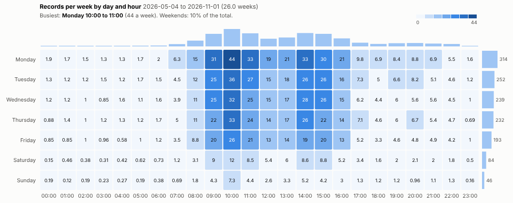
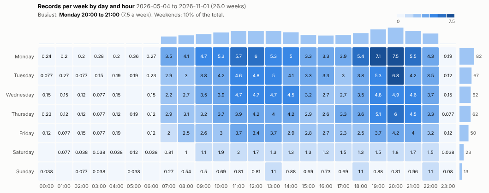
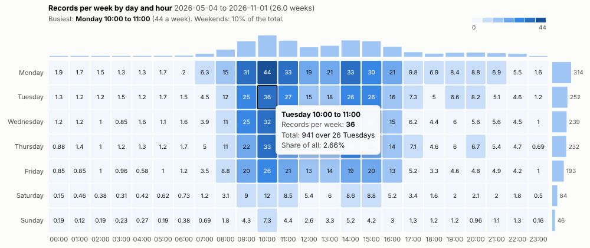
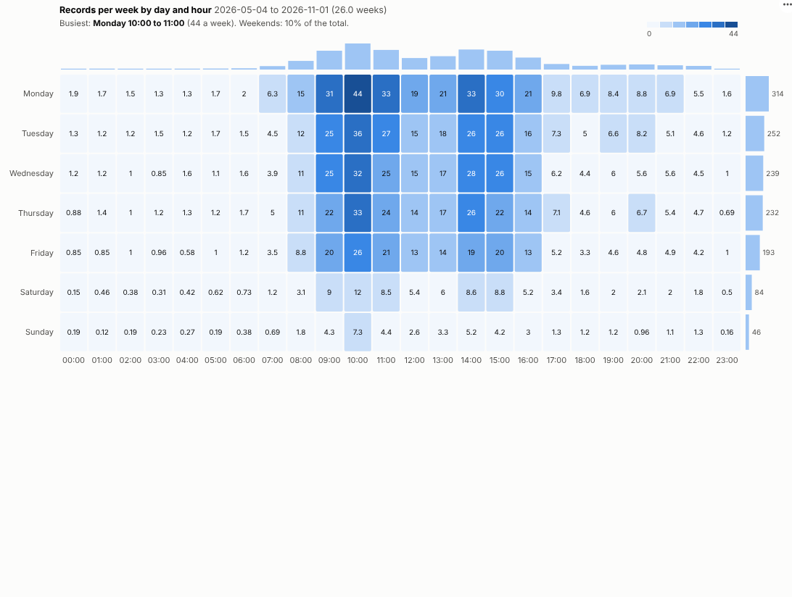

# Weekly Pattern

When are you busiest? See the week at a glance, hour by hour, from any timestamped data, and plan staff, capacity and campaigns around it.

## The problem it solves

Demand is rarely flat. Calls pile up on Monday mornings, orders arrive in the evening, visits drop at the weekend. Planning rotas, opening hours, maintenance windows and campaign timing all depend on knowing the shape of the week. A line chart over months hides it, and a pivot of weekday by hour has to be built by hand with derived fields.

The Weekly Pattern view builds it directly from timestamps. It aggregates per hour on the server, folds the hours into a week, and shows the average per week so that any period can be compared. In the illustrative contact-centre data above, the busiest hour is Monday 10:00, demand falls away after 16:00, and weekends carry about a tenth of the week. Filter to chat and the evening peak appears:

## Where it earns its place

The examples below are illustrative.

| Team | Timestamps | Decision |
|---|---|---|
| Contact centres | Calls, chats, emails | Rotas, break times, channel staffing |
| Retail and hospitality | Transactions, footfall | Opening hours, shift patterns |
| Logistics | Orders, deliveries, picks | Warehouse shifts, cut-off times |
| IT and security | Logins, incidents, alerts | Maintenance windows, unusual activity |
| Marketing | Visits, sign-ups, opens | When to send and post |

## How to use it in Omniscope

1. Bring timestamped records into a workflow (calls, orders, visits, tickets).
2. Connect it to a Report block, add a view and choose **Weekly Pattern**.
3. Set **Timestamps** and, optionally, a **Measure** such as sum of handling minutes for workload rather than volume.
4. Use **Shift hours** if the times are stored in UTC.
5. Click a cell, a day or an hour to select those records and see what drives them in other views.

## Why do this in Omniscope

- **Timestamps in, pattern out.** Weekday and hour come straight from the timestamp, so the workflow only has to deliver the records; there are no derived fields to prepare.
- **A fixed-size query however many events.** One aggregated query per hour, so a year is about 8,800 rows whether it holds a thousand events or a million (tested with 400,000).
- **Weekly averages that reconcile.** The tests check per-week averages and day totals against an independent calculation.
- **From a cell to its causes.** Selecting Monday mornings shows their reasons, channels and outcomes in the rest of the report.
- **Half-hour slots for rotas.** The query and the fold into the weekly grid are both in the view's script; change them in the View Designer for finer slots.

## Data and options

One row per event with a date and time.

| Option | What it does |
|---|---|
| Timestamps | Date and time of each record |
| Measure | Optional: count or sum per hour |
| Show | Average per week or total |
| Shift hours | Convert times, e.g. UTC to local |

Tested with 400,000 events over two years.

## Tested

- Mock harness: per-week averages and day totals checked against an independent calculation, a summed and an averaged measure, hover, selecting a cell and a day (as hour ranges), clearing, filtering to one channel, a narrow layout, a date-only field, empty data, unconfigured options, and 400,000 events.
- Real Omniscope server: installed through the Edit View API and configured in a report; identical figures.

