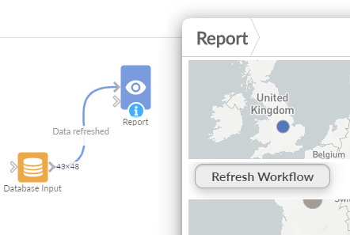

#  Workflow Execution

A button in a report that executes blocks of the project's workflow. Report viewers can refresh the data, or run an export or a model, without opening the workflow, and see the job go from queued to running to finished.

The view calls the project's [Workflow REST API](https://help.visokio.com/support/solutions/articles/42000073133-workflow-execution-rest-apis): `POST <project>.iox/w/execute`, then `GET <project>.iox/w/job/<job id>/state` once a second until the job ends.

## Use case

- A "Refresh data" button on a dashboard whose sources change during the day.
- Re-running a model, a forecast or an export block on demand, from the report its results appear in.
- Giving viewers who may not edit the workflow a single, safe action on it.

## Data

None: the view does not read the report's data, and filters do not affect it. It can sit on any report tab.

## Settings

- **Blocks to execute**: the names of the blocks, separated by commas, for example `Load orders, Report`. Leave it empty to execute the whole workflow. Omniscope also executes any upstream blocks the named ones need.
- **Button text**: the text on the button (default "Execute").
- **Refresh from source** (default on): the blocks reload their data from the sources. Off: data already loaded upstream is reused where possible.
- **Show job state** (default on): shows the job's progress under the button (Queued, Running, Finished at 14:05:31). Errors are shown whether or not this is on.

## Requirements

The viewer's user needs the **Workflow Execution via APIs** permission on the Omniscope server (off by default). Without it the view shows "Not allowed (HTTP 401)" and names the permission.

## Interaction

Press the button to start the execution. The button is disabled, with a spinner, until the job has finished, failed or been cancelled, so a second press cannot queue a second run. If the server refuses the request, its message is shown: for example a block name that is not in the workflow ("One or more blocks could not be found"), or another execution of the project already running. If Omniscope reloads the view while the job runs (it does when a block the view reads is executed, or a parameter it reads changes), the view picks the job up again and shows its progress and result. The result stays shown for two minutes after such a reload.

The view has nothing to select. A click on empty space clears the report's selection, as in other views; a click on the button does not.

## Related views

[Sequential Workflow Execution](../sequentialworkflowexecution) executes blocks one after another; [Set Parameters and Execute](../setparamandexecute) and [Switch Param and Execute Workflow](../switchparamandexecute) set project parameters first; [Lambda Workflow Execution](../lambdaworkflowexecution) runs in a copy of the project.

## Third-party libraries

None: the view is plain HTML and JavaScript and needs nothing beyond Omniscope's custom view API.
