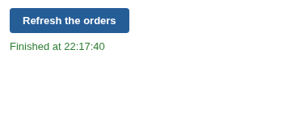

# Workflow Execution

A button in the report that runs the workflow behind it. Viewers refresh the data, or run an export, without opening the workflow.

## The problem it solves

A report is only as current as the last execution of its workflow. Authors can execute blocks from the workflow editor, and the Scheduler runs them at set times, but a viewer who needs the figures now, or wants to run an export after checking the numbers, has no way to do it from the report.

The Workflow Execution view puts that action in the report: a button that executes the blocks you name, and a status line that follows the job from queued to running to finished. Above, the button would execute the illustrative blocks Load orders and Report.

## Where it earns its place

The examples below are illustrative.

| Team | Button |
|---|---|
| Sales operations | Refresh today's orders from the CRM before the morning meeting |
| Finance | Re-run the month-end reconciliation after a late journal |
| Data team | Re-train a model block and refresh its scores |
| Customer service | Export the open cases to a shared folder |

## How to use it in Omniscope

1. Give the users who should press the button the **Workflow Execution via APIs** permission on the server.
2. In the report, add a view and choose **Workflow Execution**.
3. Type the block names in **Blocks to execute**, separated by commas (empty runs the whole workflow).
4. Set **Button text**, and choose whether to **Refresh from source**.

## Why do this in Omniscope

- **The report runs its own workflow.** The button executes the same blocks an author would execute in the workflow editor, so the views next to it are rebuilt from fresh data, with no separate script, export or scheduler job to keep in step.
- **Controlled.** Viewers can execute only the blocks you name, and only with the server permission you grant; they cannot change the workflow.
- **Open code.** The view is under 300 lines of plain HTML and JavaScript over the documented Workflow REST API, editable in the View Designer: add a confirmation step, a second button or a different message.

## Data and options

No data is needed; the view can sit on any report tab.

| Option | What it does |
|---|---|
| Blocks to execute | Block names, separated by commas; empty runs the whole workflow |
| Button text | The label on the button |
| Refresh from source | Reload from the sources, or reuse data already loaded upstream |
| Show job state | Show the job's progress (errors always show) |

## Tested

Mock harness with a stand-in for the Workflow REST API: the request each click sends (blocks, Refresh from source, the project URL taken from the report's address), the job followed to Finished, a failed job, a block name that is not in the workflow, another execution already running, a refused permission, a second press while running (ignored), Show job state off, filtering (sends nothing), a 120 by 50 pane, empty data, no settings (runs the whole workflow) and 40 block names; and a reload of the view in the middle of a run (the view resumes and shows the result).
