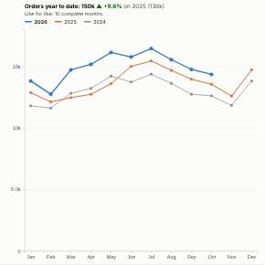

#  Year on Year

This year against last year, the comparison every business makes. The view draws one line per year across the months (or quarters, weeks or days) of the year, the current year in blue and the previous year in orange, with older years in grey. It states the year-to-date total and its change on a like-for-like basis (only complete periods, against the same periods a year earlier), supports financial years that start in any month, and can show running totals through the year.

## Use case

Monthly trading updates, sales and revenue reporting, website traffic, call volumes, footfall, energy use: any measure where the question is "are we ahead of last year?", in calendar or financial years.

## Data

Records with a date and a measure; daily or transaction-level data is fine. The view runs one aggregated query per period and one for the latest date, which tells it whether the latest period is complete. Filters from other views apply.

## Settings

- **Dated by**: the date field.
- **Measure**: what to compare, e.g. sum of Revenue (default: number of records).
- **Period**: month (default), quarter, week or day.
- **Show**: each period, or a running total through the year.
- **Years shown**: the number of most recent years (default 3).
- **Year starts in month**: 1 for calendar years, 4 for a UK financial year starting in April, and so on. Financial years are labelled like 2026/27.

## Reading the chart

The headline gives the year-to-date total and its change on the previous year, comparing only the complete periods of the current year with the same periods a year earlier. If the latest period is incomplete (the data stops part way through it), it is drawn dashed, marked in the table and left out of the comparison. The panel lists each period for the current and previous year with the change.

## Interaction

Hover anywhere for the values of every year at that period, with the change on the year before. Click a point to select that period, or a year in the legend to select the whole year, so other views filter or highlight to match; click again or click empty space to clear.

## Motion

When the view first draws, and when its data, options or filters change, the year lines draw from left to right. Hovering and selecting do not replay it. The animation is skipped when the viewer's system asks for reduced motion.

## Third-party libraries

Loaded from the jsDelivr CDN when the view opens, so the browser showing the report needs internet access:

- [D3](https://d3js.org) 7.9.0, ISC licence

## About this view

This view carries the `visokio-agents` tag. It is one of a set of community examples built by Visokio's agents, to extend Omniscope's core views with popular, specialist and more unusual use cases, and to show what anyone, people or agents, can build on Omniscope. It is tested by automated tests and was run on a real Omniscope server. It was not reviewed by Omniscope's core team, so it is not on a par with Omniscope's core views, which have years of manual, functional and unit tests behind them.

The sample data in `sample-data/` is invented for the demo.
