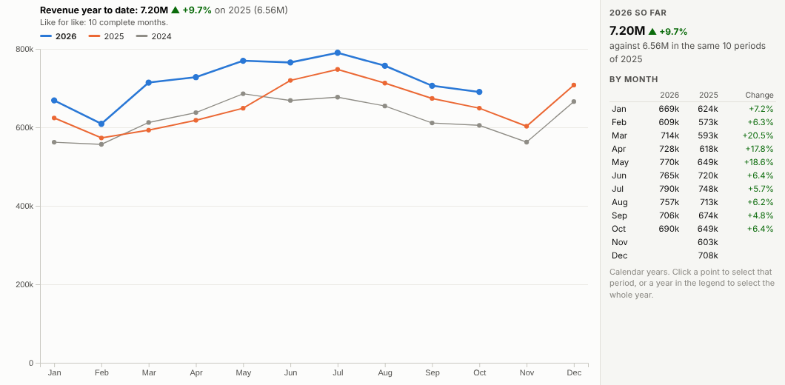
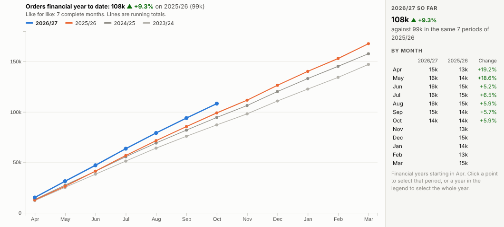
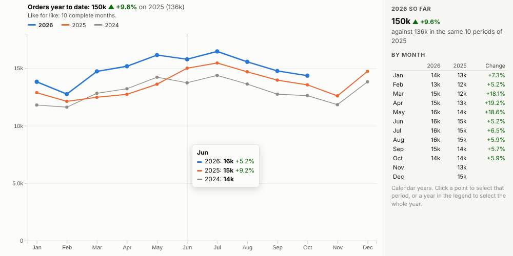
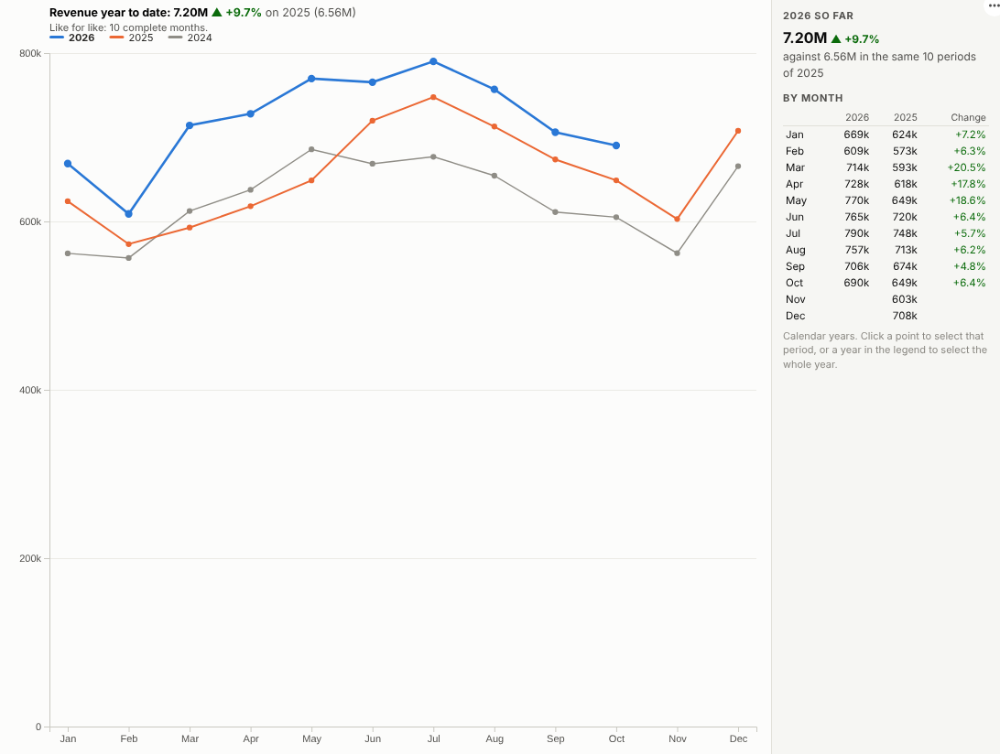

# Year on Year

Are we ahead of last year? This year against previous years, month by month, with a like-for-like year-to-date figure and financial years that start when yours do.

## The problem it solves

"How are we doing against last year?" is asked in every trading update, board pack and sales meeting. Answering it well is fiddlier than it looks: a time-series line puts the years end to end rather than on top of each other, the current month is usually incomplete and makes the year look worse than it is, and financial years starting in April break the calendar-year groupings.

The Year on Year view handles all of this. Years are overlaid on the same months, the current year is highlighted, and the headline compares complete periods only, against the same periods a year earlier. In the illustrative data above, revenue for 2026 so far is about 10% ahead of 2025, and every month has beaten the same month last year. Switch to running totals and UK financial years:

## Where it earns its place

The examples below are illustrative.

| Team | Measure | Year |
|---|---|---|
| Finance | Revenue, margin, costs | Financial year |
| Retail and hospitality | Sales, transactions, footfall | Calendar or trading year |
| Marketing | Visits, leads, sign-ups | Calendar year |
| Operations | Orders, calls, deliveries | Financial year |
| Facilities | Energy and water use | Calendar year |

## How to use it in Omniscope

1. Bring the data into a workflow with a date and a measure (daily or transaction-level is fine).
2. Connect it to a Report block, add a view and choose **Year on Year**.
3. Set **Dated by** and **Measure**, and the **Period**.
4. For financial years, set **Year starts in month** (4 for April).
5. Click a month to select it and see what is behind the change in other views.

## Why do this in Omniscope

- **No copying forward.** The comparison is read from the workflow's data and updates when it refreshes, whatever the financial year.
- **Like for like.** Incomplete periods are detected and left out of the year-to-date change, and the tests check the calendar and financial year-to-date totals against an independent calculation.
- **Your year, your slice.** Financial years start in any month and are labelled the way finance teams write them; filters recalculate the comparison for a channel, region or product.
- **A plan line next to the years.** The chart code is open; add a target or plan series in the View Designer if the question is also "are we on plan?".

## Data and options

A date and a measure.

| Option | What it does |
|---|---|
| Dated by | The date field |
| Measure | What to compare |
| Period | Month, quarter, week or day |
| Show | Each period or running total |
| Years shown | Number of years drawn |
| Year starts in month | Calendar or financial year |

Tested with 450,000 records over five years.

## Tested

- Mock harness: calendar and financial year-to-date totals checked against an independent calculation, incomplete-period detection, weekly periods, hover, selecting a month and a whole year, clearing, filtering to one channel, a narrow layout, a single year, empty data, unconfigured options, and 450,000 records.
- Real Omniscope server: installed through the Edit View API and configured in a report; identical figures.

